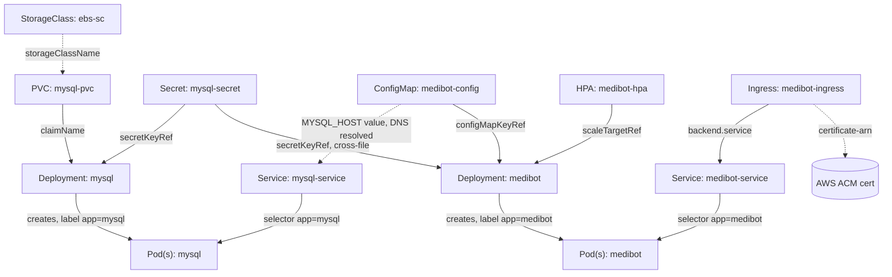

# MediBot — Kubernetes Manifests Explained
### A field-by-field, beginner-friendly walkthrough of everything in `medibot-manifests`

> This explains the 5 YAML files that live in the `medibot-manifests`
> GitHub repo — what every single field means, why it's there, and
> exactly how each resource refers to another (by name, by label, by
> DNS, or by raw AWS ARN). All YAML shown here is the **real, current
> content** of the actual repo, not a simplified example.

---

## Table of Contents

1. [Kubernetes Basics, in Plain English](#1-kubernetes-basics-in-plain-english)
2. [The Big Picture — 5 Files, 9 Resources](#2-the-big-picture--5-files-9-resources)
3. [`storageclass.yaml` Explained](#3-storageclassyaml-explained)
4. [`mysql.yaml` Explained](#4-mysqlyaml-explained)
5. [`deployment.yaml` Explained](#5-deploymentyaml-explained)
6. [`hpa.yaml` Explained](#6-hpayaml-explained)
7. [`ingress.yaml` Explained](#7-ingressyaml-explained)
8. [The Complete Reference Map](#8-the-complete-reference-map)
9. [General Beginner FAQ](#9-general-beginner-faq)
10. [Command Cheat Sheet](#10-command-cheat-sheet)

---

## 1. Kubernetes Basics, in Plain English

Skip this section if you already know what a Pod, Deployment, and
namespace are. If any of those words are new, read this first — every
later section assumes you understand these.

**Cluster** — the whole system: a group of servers (called "nodes")
that Kubernetes manages as one unit. Your EKS cluster has 3 nodes.

**Node** — one physical/virtual machine in the cluster (one of your 3
EC2 worker instances). Pods run *on* nodes.

**Pod** — the smallest thing Kubernetes actually runs. A Pod wraps one
or more containers (almost always just one, in this project) and gives
them a single shared network identity (one IP address). You never
create a Pod directly in this project — a **Deployment** creates and
manages Pods for you.

**Deployment** — a *manager* for Pods. You tell it "I want 2 copies of
this container running, always" and it continuously makes that true:
if a Pod crashes, the Deployment notices and starts a replacement; if
you update the image, it replaces old Pods with new ones gradually.
You almost never interact with Pods directly in day-to-day work — you
edit the Deployment, and Kubernetes figures out which Pods to add,
remove, or replace.

**Service** — a stable network address that sits in front of a
changing set of Pods. Pods come and go and get new IPs constantly
(every restart = a new IP) — a Service gives you one unchanging name
and IP to talk to "whichever Pods are currently healthy," by
continuously watching for Pods that match a **label selector** (see
below).

**Namespace** — a folder-like boundary inside one cluster. Everything
in this project lives in the `webapps` namespace, which is why every
single `kubectl` command you'll ever run against these resources needs
`-n webapps` (or `--namespace webapps`) — without it, `kubectl`
defaults to the `default` namespace and will tell you the resource
"not found," even though it genuinely exists, just somewhere else.

**Labels** — arbitrary key-value tags you stick on objects (e.g.
`app: medibot`). They have no built-in meaning to Kubernetes by
themselves — they only matter because *other* objects (Services, the
Deployment's own Pod-management logic, the HPA) are configured to
*search* for objects carrying a specific label. This "search by label"
mechanism is how almost every cross-resource link in this project
actually works under the hood, and it trips up nearly every beginner
at least once — see the callouts throughout this doc.

**Manifest** — just the YAML file itself: a text description of
"here's the resource(s) I want to exist." Kubernetes doesn't run the
YAML file — it reads it, and makes the real cluster state match what's
described. "Applying" a manifest (`kubectl apply -f file.yaml`, or in
this project, **ArgoCD doing that automatically for you** every time
you push to `medibot-manifests`) is the act of handing that
description to Kubernetes.

**The four things every manifest has:**

```yaml
apiVersion: ...   # which version of the Kubernetes API defines this kind of object
kind: ...         # what TYPE of object this is (Pod, Deployment, Service, Secret, ...)
metadata:         # the object's name, namespace, and labels
  name: ...
  namespace: ...
spec:             # the actual configuration — differs completely per kind
  ...
```

If you remember nothing else from this section: **Kubernetes resources
refer to each other almost entirely by plain string matching** — a
`name:` field in one object has to be typed *exactly* the same in
another object's reference to it, or the link silently fails. There is
no autocomplete, no compiler, no IDE catching a typo here — a single
character difference is a real, common, hard-to-spot bug. This
document calls out every single one of these links explicitly.

---

## 2. The Big Picture — 5 Files, 9 Resources

| File | Resources inside (separated by `---`) | What it's for |
|---|---|---|
| `storageclass.yaml` | 1 `StorageClass` | Tells Kubernetes *how* to create a real AWS EBS volume when something asks for storage |
| `mysql.yaml` | 1 `Secret`, 1 `PersistentVolumeClaim`, 1 `Deployment`, 1 `Service` | The database — a MySQL container with durable disk storage |
| `deployment.yaml` | 1 `ConfigMap`, 1 `Deployment`, 1 `Service` | The MediBot application itself |
| `hpa.yaml` | 1 `HorizontalPodAutoscaler` | Automatically scales the MediBot app up/down based on CPU load |
| `ingress.yaml` | 1 `Ingress` | Exposes the app to the public internet over HTTPS |

That `---` you'll see inside the YAML files is a YAML "document
separator" — it's how one file packs multiple independent Kubernetes
objects together. Each file could technically be 3–4 separate files
instead; they're just bundled together here because they're logically
related (e.g. everything MySQL needs lives in one file).

All 9 objects live in the same namespace: `webapps`. All of them are
synced into the cluster by ArgoCD automatically whenever
`medibot-manifests`' `main` branch changes — you never run
`kubectl apply` by hand against this repo's content.

---

## 3. `storageclass.yaml` Explained

```yaml
apiVersion: storage.k8s.io/v1
kind: StorageClass
metadata:
  name: ebs-sc
provisioner: ebs.csi.aws.com
parameters:
  type: gp3
  fsType: ext4
reclaimPolicy: Retain
volumeBindingMode: WaitForFirstConsumer
```

**What even *is* a StorageClass?** Think of it as a *template* or
*recipe* for creating storage, not storage itself. When something
(like MySQL, in the next section) says "I need 5GB of disk," it
doesn't ask AWS directly — it creates a `PersistentVolumeClaim` (a
*request*) that references this StorageClass by name, and the
StorageClass's "recipe" is what actually gets followed to create a
real EBS volume. The relationship is: **PersistentVolumeClaim
(request) → StorageClass (recipe) → PersistentVolume (the real,
created thing, auto-generated, you never write this one yourself) →
real AWS EBS volume.**

| Field | Meaning |
|---|---|
| `metadata.name: ebs-sc` | The name other objects reference. **[LINK]** `mysql.yaml`'s PVC references this exact string in its `storageClassName` field — if even one character differs, the PVC will never bind to any storage and sits in `Pending` forever. |
| `provisioner: ebs.csi.aws.com` | Which piece of software actually creates the volume. This string identifies the **AWS EBS CSI driver** — the same addon installed automatically by Terraform (`aws_eks_addon.ebs_csi` in `main.tf`) and verified in the main setup guide's Step 13. Without those pods running healthy in `kube-system`, this provisioner string points at nothing, and nothing ever gets created. |
| `parameters.type: gp3` | The EBS volume *type* to create — `gp3` is AWS's current general-purpose SSD type (cheaper and more configurable than the older `gp2`). |
| `parameters.fsType: ext4` | The filesystem to format the new volume with — a standard Linux filesystem. |
| `reclaimPolicy: Retain` | What happens to the real EBS volume if the PVC that's using it gets deleted. `Retain` means the volume survives, becoming "orphaned" (unattached to anything) rather than being destroyed. The alternative, `Delete`, would destroy the volume automatically along with the PVC. This is *why* the Teardown Manual in the main guide has a dedicated step to hunt down and manually delete leftover EBS volumes — they don't clean themselves up. |
| `volumeBindingMode: WaitForFirstConsumer` | *When* to actually create the real volume. `WaitForFirstConsumer` delays creation until a Pod that will use the volume is actually scheduled onto a specific node — this matters because EBS volumes exist in one specific Availability Zone, and this ensures the volume is created in the *same* AZ as the Pod, rather than risking a volume in the wrong AZ that the Pod's node can never attach to. The alternative, `Immediate`, creates the volume right away, before Kubernetes even knows which node will use it — riskier. |

**FAQ:**

**Q: Do I create this once, or every time I redeploy?**
A: It already exists as a committed file in `medibot-manifests` and
gets re-applied by ArgoCD every time the cluster is rebuilt. You never
hand-run this yourself — but note that a `StorageClass` is a
cluster-wide object (no `namespace:` field at all, unlike everything
else in this project), so there's nothing to "re-create per namespace"
either.

**Q: What error do I see if this is missing or misspelled?**
A: Run `kubectl describe pvc mysql-pvc -n webapps` — you'll see
something like
`waiting for a volume to be created, either by external provisioner "ebs.csi.aws.com" or manually created by system administrator`,
and the PVC's `STATUS` column (`kubectl get pvc -n webapps`) will show
`Pending` indefinitely.

---

## 4. `mysql.yaml` Explained

This one file defines **4 separate Kubernetes objects**, separated by
`---`. Go through them in order — each one builds on the last.

### 4.1 — The `Secret`

```yaml
apiVersion: v1
kind: Secret
metadata:
  name: mysql-secret
  namespace: webapps
type: Opaque
stringData:
  MYSQL_ROOT_PASSWORD: "MediBot@2025"
  MYSQL_DATABASE: "medibotdb"
```

| Field | Meaning |
|---|---|
| `kind: Secret` | A Kubernetes object meant for sensitive values (passwords, tokens, keys) — mechanically almost identical to a `ConfigMap` (see Section 5.1), but Secrets are base64-encoded at rest and the Kubernetes dashboard/CLI hide their values by default in casual listing. **This is NOT real encryption** — anyone with permission to `kubectl get secret ... -o yaml` can trivially decode it (pipe the value through `base64 -d`). Treat it as "hidden from a casual glance," not "actually protected." |
| `type: Opaque` | The generic, no-special-meaning Secret type — used for arbitrary key/value data like this. (Other types exist for TLS certs, Docker registry credentials, etc., with extra built-in validation — not relevant here.) |
| `stringData:` | A convenience field: you write plaintext here, and Kubernetes automatically base64-encodes it into the real underlying `data:` field at the moment you apply it. If you ever `kubectl get secret mysql-secret -n webapps -o yaml`, you'll see `data:` with base64 strings, not `stringData:` with plaintext — that's expected. |
| `MYSQL_ROOT_PASSWORD` / `MYSQL_DATABASE` | Just key names you've chosen — they have no special meaning to Kubernetes itself. They only become meaningful because the MySQL container image (below) and the app's Deployment are both *written* to look for keys with these exact names. |

**⚠️ Security note:** this password (`MediBot@2025`) is committed in
plaintext to Git. Anyone with read access to this repo — including its
full history, even after you later change the value — can read it.
Fine for a personal learning project; never acceptable for anything
real without a proper secrets manager.

### 4.2 — The `PersistentVolumeClaim`

```yaml
apiVersion: v1
kind: PersistentVolumeClaim
metadata:
  name: mysql-pvc
  namespace: webapps
spec:
  accessModes: [ReadWriteOnce]
  storageClassName: ebs-sc
  resources:
    requests:
      storage: 5Gi
```

| Field | Meaning |
|---|---|
| `accessModes: [ReadWriteOnce]` | How many nodes can mount this volume read-write *at the same time*. `ReadWriteOnce` (the only mode EBS actually supports) means exactly **one** node, ever, at a time — this is *why* the MySQL Deployment below uses `strategy: Recreate` instead of the default rolling update: two Pods (old + new) can never both hold this volume simultaneously during a rollout. |
| `storageClassName: ebs-sc` | **[LINK]** This must exactly match `storageclass.yaml`'s `metadata.name`. This is the request-to-recipe connection described in Section 3. |
| `resources.requests.storage: 5Gi` | How large a volume to create — 5 gibibytes. |

### 4.3 — The `Deployment`

```yaml
apiVersion: apps/v1
kind: Deployment
metadata:
  name: mysql
  namespace: webapps
spec:
  selector:
    matchLabels:
      app: mysql
  strategy:
    type: Recreate
  template:
    metadata:
      labels:
        app: mysql
    spec:
      containers:
      - name: mysql
        image: mysql:8
        env:
        - name: MYSQL_ROOT_PASSWORD
          valueFrom:
            secretKeyRef:
              name: mysql-secret
              key: MYSQL_ROOT_PASSWORD
        - name: MYSQL_DATABASE
          valueFrom:
            secretKeyRef:
              name: mysql-secret
              key: MYSQL_DATABASE
        ports:
        - containerPort: 3306
        resources:
          requests:
            memory: "512Mi"
            cpu: "500m"
          limits:
            memory: "1Gi"
            cpu: "1"
        volumeMounts:
        - mountPath: /var/lib/mysql
          name: mysql-data
      volumes:
      - name: mysql-data
        persistentVolumeClaim:
          claimName: mysql-pvc
```

> 🔑 **The most important, most commonly misunderstood thing in this
> entire file:** `spec.selector.matchLabels` (`app: mysql`) **must
> exactly match** `spec.template.metadata.labels` (`app: mysql`).
> `selector` is how the Deployment finds and "owns" the Pods it's
> responsible for managing; `template` is the actual recipe used to
> *create* those Pods. If these two don't match, Kubernetes **rejects
> the Deployment outright at apply time** with a validation error — it
> refuses to create a Deployment that can never find its own Pods.
> This is deliberate, by far the single most common beginner mistake
> when hand-writing a Deployment, and the reason `kubectl apply`
> sometimes fails with `selector does not match template labels`.

| Field | Meaning |
|---|---|
| `spec.selector.matchLabels` | The label the Deployment searches for to decide "which Pods belong to me." |
| `spec.strategy.type: Recreate` | On an update, kill the old Pod *completely* before starting the new one (instead of the default `RollingUpdate`, which starts the new Pod before killing the old). Required here because of the `ReadWriteOnce` volume constraint explained above. |
| `spec.template` | The actual Pod template — everything from here down describes what each Pod running MySQL looks like. |
| `image: mysql:8` | A public image from Docker Hub — MySQL version 8, officially maintained. No account/credentials needed to pull it (unlike the `medibot` app's own image, which comes from your private ECR). |
| `env:` with `valueFrom.secretKeyRef` | **[LINK]** Instead of a literal value, this says "go get the actual value from the Secret named `mysql-secret` (defined above, Section 4.1), specifically its `MYSQL_ROOT_PASSWORD` key." This is exactly how the MySQL container ends up knowing its own root password — the official `mysql:8` image is written to read this specific environment variable name at container startup and use it to set the actual database root password. |
| `ports.containerPort: 3306` | Documents which port the container listens on — MySQL's standard port. **Beginner note:** this field is informational/self-documenting; it does *not* by itself control or restrict any networking. Even without it, the Service below would still be able to route traffic to port 3306 on the Pod's IP — Kubernetes networking isn't firewalled by `containerPort` declarations. |
| `resources.requests` / `resources.limits` | `requests` is what Kubernetes *reserves* for scheduling purposes (guarantees this much is available on whichever node the Pod lands on) — it also affects in HPA math for autoscaling targets (see Section 6). `limits` is a hard ceiling: if the container tries to use more memory than its limit, it gets forcibly killed (`OOMKilled`); if it tries to use more CPU than its limit, it's simply throttled, not killed. |
| `volumeMounts` / `volumes` | **[LINK, two-step]** `volumeMounts.name: mysql-data` must match `volumes[].name: mysql-data` — this link is *local to this one Pod spec*, just connecting "where to mount it inside the container" (`mountPath`) to "which named volume to mount." Then separately, `volumes[].persistentVolumeClaim.claimName: mysql-pvc` must match the PVC's `metadata.name` from Section 4.2 — *that's* the link to the actual durable storage. |

### 4.4 — The `Service`

```yaml
apiVersion: v1
kind: Service
metadata:
  name: mysql-service
  namespace: webapps
spec:
  ports:
  - port: 3306
    targetPort: 3306
  selector:
    app: mysql
```

| Field | Meaning |
|---|---|
| `metadata.name: mysql-service` | **[LINK]** This name is what `deployment.yaml`'s `MYSQL_HOST` ConfigMap value is set to (see Section 5.1) — Kubernetes' internal DNS automatically makes every Service resolvable by its name (within the same namespace) or its full form `mysql-service.webapps.svc.cluster.local` (from anywhere in the cluster). |
| (no `type:` specified) | Defaults to `ClusterIP` — meaning this Service only gets an internal cluster IP, reachable from *inside* the cluster, never from the public internet. That's intentional: nothing outside the cluster should ever talk to the database directly. |
| `ports.port: 3306` | The port *other things inside the cluster* connect to on this Service's own internal IP/DNS name. |
| `ports.targetPort: 3306` | The port on the *actual Pod* that traffic gets forwarded to. Here they're the same number, but they don't have to be (see `deployment.yaml`'s Service in Section 5.3 for an example where they genuinely differ). |
| `selector.app: mysql` | **[LINK]** This is the mechanism described in Section 1: the Service continuously watches for any Pod in this namespace carrying the label `app: mysql`, and automatically load-balances traffic across all of them — right now that's the one Pod the `mysql` Deployment manages. |

**FAQ:**

**Q: What happens to my data if I `kubectl delete pod mysql-xxxxx`?**
A: Nothing is lost. The Deployment notices its managed Pod is gone and
immediately creates a replacement, which mounts the *same* PVC
(`mysql-pvc`) and therefore the same underlying EBS volume — all the
data is still there. Deleting a Pod that's managed by a Deployment is
safe and routine; it's exactly how rolling updates and crash recovery
work.

**Q: What if I `kubectl delete pvc mysql-pvc`?**
A: This is destructive — Kubernetes detaches the real EBS volume from
Kubernetes' tracking, and because `reclaimPolicy: Retain` is set, the
underlying EBS volume itself survives (orphaned, costing money, doing
nothing) rather than being deleted, but your database has no way to
reattach to it automatically — a new PVC with the same name would get
a *brand-new, empty* volume, not the old data.

**Q: Why does the Deployment show only 1 replica, not 2 like the app?**
A: There's no `replicas:` field at all in `mysql.yaml`'s Deployment
spec, and Kubernetes defaults to `1` when it's omitted. This is
deliberate — a second MySQL replica wouldn't help without real MySQL
replication configured, and would actively break given the
`ReadWriteOnce` single-attachment volume constraint.

---

## 5. `deployment.yaml` Explained

Also 3 objects in one file: a `ConfigMap`, the app's `Deployment`, and
its `Service`.

### 5.1 — The `ConfigMap`

```yaml
apiVersion: v1
kind: ConfigMap
metadata:
  name: medibot-config
  namespace: webapps
data:
  BEDROCK_REGION: "ap-south-1"
  BEDROCK_MODEL_ID: "apac.amazon.nova-lite-v1:0"
  MYSQL_HOST: "mysql-service"
  MYSQL_DB: "medibotdb"
```

**ConfigMap vs Secret — when to use which:** mechanically almost
identical (both are just key-value stores a Pod can read from), but a
`ConfigMap` is for **non-sensitive** configuration — values that would
be fine to see in plaintext in a `kubectl get configmap -o yaml`, in
logs, or in a screenshot. Region names, model IDs, and service hostnames
aren't secrets; passwords are — that's the entire reason this data is
split across a `ConfigMap` here and a `Secret` in `mysql.yaml`.

| Key | Where its value comes from | **[LINK]** |
|---|---|---|
| `BEDROCK_REGION` | Just a plain string, `ap-south-1` | None — self-contained |
| `BEDROCK_MODEL_ID` | Just a plain string, the Nova inference profile ID | None — self-contained, but must match an ID AWS Bedrock actually recognizes (see the main setup guide's Phase 5) |
| `MYSQL_HOST` | `"mysql-service"` | **This is the exact `metadata.name` of the Service defined in `mysql.yaml` Section 4.4.** This is how the app Pod knows *where* to find the database — not an IP address, a DNS name that Kubernetes' internal DNS resolves automatically. |
| `MYSQL_DB` | `"medibotdb"` | Matches the `MYSQL_DATABASE` value inside `mysql-secret` (Section 4.1) — same database name, kept in two different places because one is "what database name to create" (consumed by the MySQL container itself) and the other is "what database name to connect to" (consumed by the app). They're not programmatically linked to each other — they just need to be typed the same by whoever wrote this. |

### 5.2 — The `Deployment`

```yaml
apiVersion: apps/v1
kind: Deployment
metadata:
  name: medibot
  namespace: webapps
spec:
  replicas: 2
  selector:
    matchLabels:
      app: medibot
  template:
    metadata:
      labels:
        app: medibot
    spec:
      containers:
      - name: medibot
        image: 719152986284.dkr.ecr.ap-south-1.amazonaws.com/medibot:v8
        ports:
        - containerPort: 8080
        env:
        - name: MYSQL_HOST
          valueFrom:
            configMapKeyRef:
              name: medibot-config
              key: MYSQL_HOST
        - name: MYSQL_DB
          valueFrom:
            configMapKeyRef:
              name: medibot-config
              key: MYSQL_DB
        - name: MYSQL_USER
          value: "root"
        - name: MYSQL_PASSWORD
          valueFrom:
            secretKeyRef:
              name: mysql-secret
              key: MYSQL_ROOT_PASSWORD
        - name: BEDROCK_REGION
          valueFrom:
            configMapKeyRef:
              name: medibot-config
              key: BEDROCK_REGION
        - name: BEDROCK_MODEL_ID
          valueFrom:
            configMapKeyRef:
              name: medibot-config
              key: BEDROCK_MODEL_ID
        resources:
          requests:
            memory: "256Mi"
            cpu: "250m"
          limits:
            memory: "512Mi"
            cpu: "500m"
        livenessProbe:
          httpGet:
            path: /api/health
            port: 8080
          initialDelaySeconds: 90
          periodSeconds: 10
        readinessProbe:
          httpGet:
            path: /api/health
            port: 8080
          initialDelaySeconds: 90
          periodSeconds: 10
```

| Field | Meaning |
|---|---|
| `replicas: 2` | Run 2 identical copies of this Pod at all times, for both redundancy (one can fail/restart without full downtime) and load distribution. **[LINK]** This number is the *starting point* — once the `HorizontalPodAutoscaler` in `hpa.yaml` is active and targeting this Deployment, the HPA takes over control of this field and adjusts it automatically based on load; manually editing `replicas:` here afterward has no lasting effect. |
| `selector`/`template.labels` `app: medibot` | Same matching-pair rule explained in Section 4.3 for MySQL — must be identical, or the Deployment is rejected outright. |
| `image: 719152986284.dkr.ecr.ap-south-1.amazonaws.com/medibot:v8` | Anatomy of this string: `719152986284` (your AWS account ID) `.dkr.ecr.` `ap-south-1` (region) `.amazonaws.com` (ECR's domain) `/medibot` (the repository name, created in the main guide's Phase 6) `:v8` (the specific image *tag* — this exact tag changes every time Jenkins successfully completes a build; whatever it currently says reflects the last build Jenkins ran). |
| `ports.containerPort: 8080` | **[LINK, triangle]** Must match the port Spring Boot's embedded web server actually listens on inside the container (8080 is Spring Boot's conventional default), **and** must match the port used in the `livenessProbe`/`readinessProbe` below, **and** must match the `targetPort` in this app's Service (Section 5.3) — if any one of these three numbers is wrong, the chain breaks (probes fail and Kubernetes kills the Pod repeatedly, or the Service can't reach a working port). |
| `env: MYSQL_HOST` / `MYSQL_DB` via `configMapKeyRef` | **[LINK]** Pulls from the `medibot-config` ConfigMap (Section 5.1) — `configMapKeyRef` works exactly like `secretKeyRef` (seen with MySQL above), just for non-sensitive data. |
| `env: MYSQL_USER value: "root"` | A **literal, hardcoded value** — not pulled from anywhere else. This is the one env var in this whole file that uses `value:` instead of `valueFrom:`, illustrating the two ways to set a container's environment variable: a plain string right here, or a reference to something else (ConfigMap/Secret). |
| `env: MYSQL_PASSWORD` via `secretKeyRef` | **[LINK, cross-file]** This is the single most important cross-file link in the whole project: this Deployment, defined in `deployment.yaml`, reaches into the `mysql-secret` Secret, which is defined in a **completely different file**, `mysql.yaml`. **Kubernetes doesn't care which YAML file originally created an object** — once applied, every object lives together in one shared pool inside its namespace, referenceable by name from anywhere else in that same namespace, regardless of which file "owns" it. Splitting resources across multiple files is purely an organizational convenience for humans reading the repo; it creates zero actual boundaries at runtime. |
| `env: BEDROCK_REGION` / `BEDROCK_MODEL_ID` via `configMapKeyRef` | Same pattern as `MYSQL_HOST`/`MYSQL_DB` — pulled from the ConfigMap. |
| `livenessProbe` vs `readinessProbe` | Two different questions Kubernetes asks the same HTTP endpoint (`GET /api/health` on port 8080), for two different purposes: **Liveness** = "is this container still working, or should I kill and restart it?" A failing liveness probe gets the Pod restarted. **Readiness** = "is this container ready to receive real user traffic right now?" A failing readiness probe doesn't restart anything — it just temporarily removes the Pod from the Service's pool of targets (Section 5.3), so users aren't routed to a Pod that's still starting up or temporarily overloaded, without killing it. |
| `initialDelaySeconds: 90` | Wait 90 seconds after the container starts before running the *first* probe at all. Spring Boot apps with a database connection and AWS SDK initialization commonly take 60–90 seconds to become genuinely ready — without this delay, Kubernetes would start probing (and likely killing, for liveness) the Pod before it ever had a chance to finish starting up. |
| `periodSeconds: 10` | After the initial delay, check again every 10 seconds, indefinitely. |
| `resources.requests.cpu: "250m"` | **[LINK]** `250m` means 250 "millicores" = a quarter of one CPU core. This exact value is what `hpa.yaml`'s `averageUtilization: 70` is calculated *against* — see Section 6. |

### 5.3 — The `Service`

```yaml
apiVersion: v1
kind: Service
metadata:
  name: medibot-service
  namespace: webapps
spec:
  type: ClusterIP
  ports:
  - port: 80
    targetPort: 8080
  selector:
    app: medibot
```

| Field | Meaning |
|---|---|
| `metadata.name: medibot-service` | **[LINK]** Referenced by name in `ingress.yaml`'s backend (Section 7) — this is how public internet traffic eventually finds its way to this Service. |
| `type: ClusterIP` | Explicit this time (MySQL's Service left it implicit) — internal-only, not reachable from outside the cluster by itself. Public access comes entirely through the separate `Ingress`/ALB layer, not through this Service's type. |
| `ports.port: 80` vs `ports.targetPort: 8080` | **A genuinely different pair of numbers** — the perfect concrete example of what `port` vs `targetPort` actually means: anything *inside the cluster* connecting to this Service uses port `80` (the Service's own, made-up, internal port number — you could pick almost anything here). Kubernetes then silently translates that to port `8080` on whichever Pod it routes the connection to — the port the actual container is listening on. The two numbers never have to match; they just happen to be identical over in `mysql-service` because `3306` made sense to use for both. |
| `selector.app: medibot` | **[LINK]** Finds Pods via the same label-matching mechanism as every other Service in this project — in this case, the 2 (or more, once the HPA scales up) Pods managed by the `medibot` Deployment. |

---

## 6. `hpa.yaml` Explained

```yaml
apiVersion: autoscaling/v2
kind: HorizontalPodAutoscaler
metadata:
  name: medibot-hpa
  namespace: webapps
spec:
  scaleTargetRef:
    apiVersion: apps/v1
    kind: Deployment
    name: medibot
  minReplicas: 2
  maxReplicas: 5
  metrics:
  - type: Resource
    resource:
      name: cpu
      target:
        type: Utilization
        averageUtilization: 70
```

| Field | Meaning |
|---|---|
| `kind: HorizontalPodAutoscaler` ("HPA") | A controller that automatically edits another object's `replicas` field based on live metrics — "horizontal" scaling means adding/removing whole Pod copies (as opposed to "vertical" scaling, which would mean giving an existing Pod more CPU/memory). |
| `spec.scaleTargetRef` | **[LINK]** A pointer, by `apiVersion` + `kind` + `name`, at the exact object this HPA controls. `name: medibot` must match `deployment.yaml`'s `metadata.name` exactly — this is how the HPA finds and starts managing that specific Deployment's `replicas` field. |
| `minReplicas: 2` / `maxReplicas: 5` | The HPA will never scale below 2 or above 5 Pods, no matter what the metrics say. |
| `metrics[0].resource.name: cpu` | Scale based on CPU usage (as opposed to memory, or a custom application metric — both are also possible with a more advanced HPA config, not used here). |
| `target.type: Utilization`, `averageUtilization: 70` | **[LINK]** "Keep the *average* CPU usage across all current Pods at around 70% of **what each Pod requested**" — and "what each Pod requested" is exactly `deployment.yaml`'s `resources.requests.cpu: "250m"` value from Section 5.2. If actual average usage climbs meaningfully above 70% of 250m, the HPA adds a Pod; if it drops well below, it removes one (down to the `minReplicas` floor). |

**This entire object depends on `metrics-server`** being installed and
healthy in the cluster (covered in the main setup guide's Phase 4,
Step 12) — the HPA reads live CPU numbers from the `metrics.k8s.io`
API, which only exists because `metrics-server` provides it. EKS does
not install this by default.

**FAQ:**

**Q: Why does `kubectl get hpa -n webapps` show `<unknown>/70%` for the
TARGETS column?**
A: Almost always means `metrics-server` isn't running or isn't healthy
— the HPA literally has no CPU numbers to compare against 70%. Can
also happen if `deployment.yaml`'s Pods have no `resources.requests.cpu`
set at all (there's nothing to calculate a percentage *of*) — not an
issue here since it's explicitly set, but worth knowing as a general
cause.

**Q: Can I set `minReplicas: 0` to save cost when there's no traffic?**
A: Not with a plain HPA like this one — standard Kubernetes HPAs
require at least 1 replica running at all times. True scale-to-zero
needs an additional system like KEDA, which isn't part of this project.

**Q: If I manually run `kubectl scale deployment medibot --replicas=4`,
what happens?**
A: It'll work *momentarily*, but the HPA re-evaluates on its own
interval (every 15 seconds by default) and will immediately overwrite
your manual change back to whatever its own CPU-based calculation says
— manual scaling and an active HPA fight each other, and the HPA
always wins.

---

## 7. `ingress.yaml` Explained

```yaml
apiVersion: networking.k8s.io/v1
kind: Ingress
metadata:
  name: medibot-ingress
  namespace: webapps
  annotations:
    kubernetes.io/ingress.class: alb
    alb.ingress.kubernetes.io/scheme: internet-facing
    alb.ingress.kubernetes.io/target-type: ip
    alb.ingress.kubernetes.io/listen-ports: '[{"HTTP": 80}, {"HTTPS": 443}]'
    alb.ingress.kubernetes.io/ssl-redirect: "443"
    alb.ingress.kubernetes.io/certificate-arn: "arn:aws:acm:ap-south-1:719152986284:certificate/8653e0eb-a10d-4250-af1f-d6f0915ca1d5"
spec:
  rules:
  - host: medibot.nihitdevops.xyz
    http:
      paths:
      - path: /
        pathType: Prefix
        backend:
          service:
            name: medibot-service
            port:
              number: 80
```

This is the only object in the entire project that reaches *outside*
Kubernetes entirely — straight into raw AWS configuration — via a
literal ARN string in an annotation.

**What an `Ingress` is, conceptually:** a *set of routing rules* for
HTTP(S) traffic coming from outside the cluster — "requests for this
hostname/path should go to that Service." On its own, an `Ingress`
object does nothing; it needs an **Ingress Controller** watching for
objects like this and actually acting on them. In this project, that
controller is the **AWS Load Balancer Controller** (installed in the
main guide's Phase 4) — a pod running in `kube-system` that watches for
`Ingress` objects and provisions a real AWS Application Load Balancer
to match.

### Annotations, one at a time

| Annotation | Meaning |
|---|---|
| `kubernetes.io/ingress.class: alb` | Tells Kubernetes *which* Ingress Controller should handle this object — a cluster could theoretically have multiple controllers installed (e.g. `alb` and `nginx`) watching for different Ingresses; this explicitly claims the AWS ALB Controller. |
| `alb.ingress.kubernetes.io/scheme: internet-facing` | The resulting ALB gets a public IP, reachable from the internet. The alternative, `internal`, would create an ALB only reachable from inside the VPC — not useful for a public-facing app. |
| `alb.ingress.kubernetes.io/target-type: ip` | Tells the ALB Controller to route traffic directly to individual Pod IP addresses (via the AWS VPC CNI networking this cluster uses), rather than routing to EC2 *instance* ports (`target-type: instance`). `ip` mode is the generally recommended approach — it works regardless of how `kube-proxy`/Services are configured internally, and is required if you ever add Fargate nodes. |
| `alb.ingress.kubernetes.io/listen-ports` | A literal JSON array (note it's a *string* containing JSON, not native YAML) telling the ALB which ports to listen on: plain HTTP on 80, and HTTPS on 443. |
| `alb.ingress.kubernetes.io/ssl-redirect: "443"` | Any request that arrives on port 80 (HTTP) gets automatically redirected to port 443 (HTTPS) instead of being served directly — this is what forces `http://medibot.nihitdevops.xyz` to become `https://medibot.nihitdevops.xyz` in a browser. |
| `alb.ingress.kubernetes.io/certificate-arn` | **[LINK, external to Kubernetes]** The exact ARN of a real certificate issued by AWS Certificate Manager (ACM) — covered in the main guide's Phase 17. This is how the ALB actually terminates HTTPS (decrypts incoming traffic) — the certificate itself lives entirely in AWS, outside Kubernetes' control; this annotation is just a pointer to it. |

### `spec`

| Field | Meaning |
|---|---|
| `rules[0].host` | Only requests for this exact hostname (`medibot.nihitdevops.xyz`) match this rule — a single ALB can host many different domains with different rules, each pointing at a different Service, though this project only uses one. |
| `http.paths[0].path: /` | Matches all paths (everything after the host). |
| `pathType: Prefix` | `/` as a *prefix* match means literally every URL path matches (since every path starts with `/`) — `Prefix` matching is the most common choice. (The alternative, `Exact`, would only match the literal string `/` itself, excluding `/api/health` etc. — not what's wanted here.) |
| `backend.service.name: medibot-service` | **[LINK]** Must exactly match the Service's `metadata.name` from Section 5.3. |
| `backend.service.port.number: 80` | **[LINK]** Must match the Service's own `port` (not `targetPort`!) — the Ingress talks to the Service's port 80, and the Service *itself* is what translates that down to the Pod's port 8080. |

### The full request path, end to end

```
Browser → HTTPS:443 → ALB (decrypts TLS using the ACM cert)
        → Ingress rule matches host+path
        → medibot-service:80 (Service)
        → medibot Pod:8080 (container)
```

**FAQ:**

**Q: Why is the `ADDRESS` column blank when I run
`kubectl get ingress -n webapps`?**
A: The ALB Controller hasn't finished provisioning the real AWS ALB
yet — this can take 1–2 minutes after the Ingress is first created.
If it stays blank much longer, check the ALB Controller's own pod logs
(`kubectl logs -n kube-system deployment/aws-load-balancer-controller`)
for permission errors (IAM policy issues) or configuration errors
(e.g. a malformed `listen-ports` JSON string).

**Q: I edited `ingress.yaml` and pushed — nothing changed in the
browser. Why?**
A: Three possible delays stack up: (1) ArgoCD needs to notice the Git
change and sync (seconds, unless sync is paused), (2) the ALB
Controller needs to notice the Kubernetes object changed and update
the real ALB's listener rules (also usually fast), and (3) your
browser or an intermediate DNS resolver may be caching the old
response — try a hard refresh or `curl -v` to rule that out.

---

## 8. The Complete Reference Map

Every cross-reference in this project, in one place:

| This object... | ...references... | ...by | Found in |
|---|---|---|---|
| `mysql-pvc` (PVC) | `ebs-sc` (StorageClass) | `storageClassName` field | `mysql.yaml` → `storageclass.yaml` |
| `mysql` (Deployment) | `mysql-secret` (Secret) | `secretKeyRef.name` (×2) | `mysql.yaml`, same file |
| `mysql` (Deployment) | `mysql-pvc` (PVC) | `volumes[].persistentVolumeClaim.claimName` | `mysql.yaml`, same file |
| `mysql-service` (Service) | `mysql` Pods | `selector.app: mysql` (label match) | `mysql.yaml`, same file |
| `medibot-config` (ConfigMap) `MYSQL_HOST` value | `mysql-service` (Service) | plain string match (`"mysql-service"`) resolved via cluster DNS | `deployment.yaml` → `mysql.yaml` |
| `medibot` (Deployment) | `medibot-config` (ConfigMap) | `configMapKeyRef.name` (×4) | `deployment.yaml`, same file |
| `medibot` (Deployment) | `mysql-secret` (Secret) | `secretKeyRef.name` | `deployment.yaml` → `mysql.yaml` (cross-file!) |
| `medibot-service` (Service) | `medibot` Pods | `selector.app: medibot` (label match) | `deployment.yaml`, same file |
| `medibot-hpa` (HPA) | `medibot` (Deployment) | `scaleTargetRef.name` | `hpa.yaml` → `deployment.yaml` |
| `medibot-hpa` (HPA) CPU math | `medibot` (Deployment) `resources.requests.cpu` | implicit — percentage calculated against this value | `hpa.yaml` → `deployment.yaml` |
| `medibot-ingress` (Ingress) | `medibot-service` (Service) | `backend.service.name` + `.port.number` | `ingress.yaml` → `deployment.yaml` |
| `medibot-ingress` (Ingress) | AWS ACM certificate | raw ARN string in an annotation | `ingress.yaml` → outside Kubernetes entirely |
| `medibot-ingress` (Ingress) | AWS ALB Controller | `kubernetes.io/ingress.class: alb` annotation | `ingress.yaml` → a pod in `kube-system` |
| `storageclass.yaml`'s `ebs-sc` | AWS EBS CSI driver | `provisioner: ebs.csi.aws.com` | `storageclass.yaml` → an addon in `kube-system` |



---

## 9. General Beginner FAQ

**Q: What's the difference between a Pod, a ReplicaSet, and a
Deployment?**
A: A **Pod** is one running instance. A **ReplicaSet** keeps a
specified number of identical Pods running (you never write one of
these by hand in this project — Kubernetes creates it for you). A
**Deployment** manages ReplicaSets on your behalf, specifically to
support rolling updates — when you change the image or any Pod spec
field, the Deployment creates a *new* ReplicaSet and gradually shifts
traffic over, keeping the old one around briefly in case you need to
roll back. You interact with the Deployment; it handles the rest.

**Q: What is `kubectl` actually talking to?**
A: Your cluster's Kubernetes API server (the EKS-managed control
plane) — every `kubectl` command is an HTTP API call, authenticated
using the credentials in your `~/.kube/config` file (set up via
`aws eks update-kubeconfig` in the main guide).

**Q: Why does every command need `-n webapps`?**
A: Because every resource in this project was created *in* the
`webapps` namespace, and `kubectl` defaults to the `default` namespace
when you don't specify one — it's not that the resource doesn't exist,
it's that you're looking in the wrong "folder."

**Q: What do the different Pod statuses mean?**

| Status | Meaning |
|---|---|
| `Pending` | Scheduled, but not yet running — often waiting on an image pull, waiting for a PVC to bind, or waiting for a node with enough free resources |
| `ContainerCreating` | Image pulled, container is being set up |
| `Running` | Healthy and operating normally |
| `CrashLoopBackOff` | The container keeps starting and immediately exiting/crashing, and Kubernetes is backing off (waiting longer between each retry) rather than restart-looping as fast as possible |
| `ImagePullBackOff` | Kubernetes can't download the specified image — wrong tag, wrong account, or missing registry credentials |
| `OOMKilled` (seen in `kubectl describe pod`, not the status column) | The container exceeded its memory `limit` and was forcibly killed |

**Q: If I run `kubectl edit deployment medibot -n webapps` and change
something, will it stick?**
A: It'll work immediately — but ArgoCD's `Self Heal` setting (covered
in the main setup guide's Phase 13) notices the drift from what's
committed in Git within seconds and reverts your manual change back to
match the repo. In this GitOps setup, **Git is the only place a change
is considered "real" and permanent** — manual `kubectl edit`/`patch`
changes are temporary unless they also go into a commit.

**Q: How do I see a resource's complete, real, live definition —
not just what I wrote in the YAML file?**
A: `kubectl get <kind> <name> -n webapps -o yaml` — this shows you
everything, including fields Kubernetes filled in automatically that
you never wrote yourself (a `status:` section, auto-generated labels,
resourceVersion, etc).

**Q: What's the difference between `kubectl get` and
`kubectl describe`?**
A: `get` gives you a short summary (good for "is it running, how many
replicas"). `describe` gives you a much more detailed human-readable
report, critically including recent **Events** at the bottom — this is
almost always where you'll find the actual reason something is stuck
or failing (a failed image pull, a scheduling failure, a failed probe).
When something's wrong, reach for `describe` before `get -o yaml`.

**Q: Labels vs. annotations — what's the real difference?**
A: Both are key-value metadata you attach to objects. **Labels** are
meant to be *selected on* — Services, Deployments, and the HPA all use
label matching to find the objects they care about (as seen throughout
this doc). **Annotations** are not selectable at all — they're just
arbitrary extra information attached to an object, often consumed by
external tooling (like every `alb.ingress.kubernetes.io/...`
annotation in `ingress.yaml`, which the ALB Controller reads but
Kubernetes itself never queries or filters by).

**Q: Could I run a second, independent copy of this whole app in a
different namespace?**
A: Yes — namespaces are exactly the mechanism for that. You'd need to
change every `namespace: webapps` to something else, and since Service
DNS names include the namespace (`mysql-service.other-namespace.svc.cluster.local`),
things would still resolve correctly as long as you're consistent.

---

## 10. Command Cheat Sheet

```bash
# See everything in the namespace at a glance
kubectl get all -n webapps

# Pods specifically, with more detail (node, restarts, age)
kubectl get pods -n webapps -o wide

# Full details + recent Events for one Pod (your first stop when debugging)
kubectl describe pod <pod-name> -n webapps

# Logs from a running Pod
kubectl logs -n webapps deployment/medibot --tail=100

# Logs from a Pod's PREVIOUS run (use when it's crash-looping)
kubectl logs -n webapps <pod-name> --previous

# Open a shell inside a running Pod
kubectl exec -it -n webapps deployment/medibot -- /bin/sh

# Check what env vars actually landed inside a container
kubectl exec -n webapps deployment/medibot -- env

# Decode a Secret's value
kubectl get secret mysql-secret -n webapps -o jsonpath="{.data.MYSQL_ROOT_PASSWORD}" | base64 -d; echo

# Check the full live YAML, including auto-filled fields
kubectl get deployment medibot -n webapps -o yaml

# Check PVC binding status
kubectl get pvc -n webapps
kubectl describe pvc mysql-pvc -n webapps

# Check HPA's current view of CPU usage vs. target
kubectl get hpa -n webapps

# Check the Ingress and its assigned ALB address
kubectl get ingress -n webapps

# Watch a resource's status update live
kubectl get pods -n webapps -w
```
