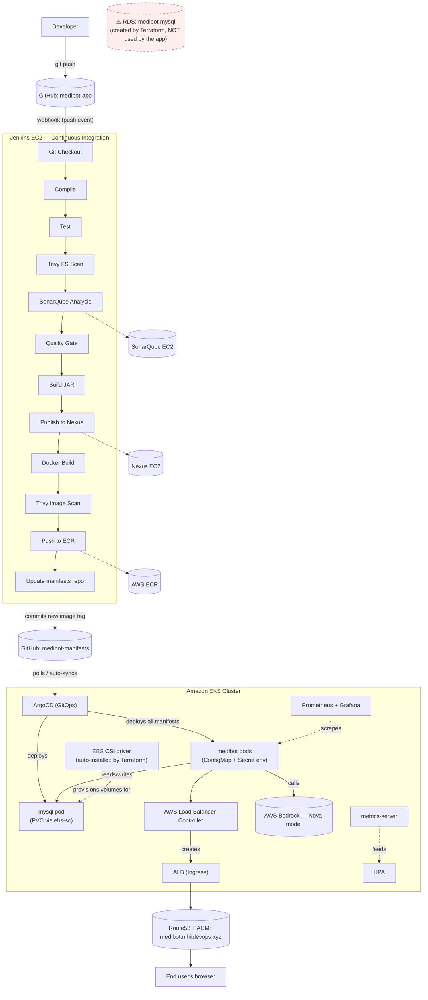

# MediBot — AI-Powered Patient Triage System
## Complete Infrastructure Setup & Teardown Guide

> A full, beginner-friendly walkthrough of standing up a production-style
> CI/CD + GitOps stack on AWS: Terraform → EKS → Jenkins → SonarQube →
> Nexus → ECR → ArgoCD → Prometheus/Grafana → Route53/ACM HTTPS.
> Every step includes **what to run**, **why it's needed**, **what
> breaks if you skip it**, and **where any secret/credential it
> produces gets used later**. This revision was re-verified directly
> against the actual Terraform (`main.tf`) and Kubernetes manifest
> files used in this project, not just the original walkthrough notes
> — see [Section 6](#6-known-architecture-quirks--things-to-decide-on)
> for things that turned up that weren't obvious from the original
> guide.

---

## Table of Contents

1. [Architecture Overview](#1-architecture-overview)
2. [How the Pieces Talk to Each Other](#2-how-the-pieces-talk-to-each-other)
3. [Secrets & Credentials Master Reference](#3-secrets--credentials-master-reference)
4. [Fixed vs. Changing Values](#4-fixed-vs-changing-values)
5. [Prerequisites](#5-prerequisites)
6. [Known Architecture Quirks & Things to Decide On](#6-known-architecture-quirks--things-to-decide-on)
7. [Phase 1 — GitHub Repos + Token](#phase-1--github-repos--token)
8. [Phase 2 — AWS Account Setup](#phase-2--aws-account-setup)
9. [Phase 3 — Management Server](#phase-3--management-server)
10. [Phase 4 — EKS Setup](#phase-4--eks-setup)
11. [Phase 5 — Bedrock IAM Permission](#phase-5--bedrock-iam-permission)
12. [Phase 6 — ECR Setup](#phase-6--ecr-setup)
13. [Phase 7 — Jenkins Setup](#phase-7--jenkins-setup)
14. [Phase 8 — SonarQube Setup](#phase-8--sonarqube-setup)
15. [Phase 9 — Nexus Setup](#phase-9--nexus-setup)
16. [Phase 10 — Jenkins Configuration](#phase-10--jenkins-configuration)
17. [Phase 11 — Kubernetes Namespace](#phase-11--kubernetes-namespace)
18. [Phase 12 — Populate the Manifests Repo](#phase-12--populate-the-manifests-repo)
19. [Phase 13 — ArgoCD Setup](#phase-13--argocd-setup)
20. [Phase 14 — Jenkins Pipeline Job](#phase-14--jenkins-pipeline-job)
21. [Phase 15 — Verify](#phase-15--verify)
22. [Phase 16 — Monitoring](#phase-16--monitoring)
23. [Phase 17 — Domain + SSL Setup](#phase-17--domain--ssl-setup)
24. [Post-Deployment Verification](#post-deployment-verification)
25. [Troubleshooting](#troubleshooting)
26. [IP Address Dependencies](#ip-address-dependencies)
27. [Complete Teardown Manual](#complete-teardown-manual)

---

## 1. Architecture Overview

MediBot is a Spring Boot application (AI patient triage, backed by AWS
Bedrock) deployed on Amazon EKS, built and shipped through a classic
**CI/CD + GitOps** split: Jenkins does Continuous Integration, ArgoCD
does Continuous Deployment, and they never talk to each other directly
— they're connected only through a Git repository.



> ⚠️ Notice the dashed red box: Terraform provisions a real RDS MySQL
> instance that the application **does not actually connect to** — see
> [Section 6](#6-known-architecture-quirks--things-to-decide-on) for
> why, and what to do about it.

### Component Inventory

| # | Component | Runs as | Purpose |
|---|---|---|---|
| 1 | GitHub repos (`medibot-app`, `medibot-manifests`) | — | Source of truth, split CI repo from CD repo |
| 2 | Management server | EC2 | Runs Terraform + kubectl safely, outside your laptop |
| 3 | Terraform | CLI on management server | Provisions VPC, 3 EC2s, EKS cluster, EBS CSI driver, RDS (unused — see Section 6), IAM roles |
| 4 | Jenkins | EC2 (bare install, not containerized) | CI: build, test, scan, publish, push, trigger CD |
| 5 | SonarQube | Docker container on its own EC2 | Static code analysis + quality gate |
| 6 | Nexus | Docker container on its own EC2 | Hosts built `.jar` artifacts (Maven repo) |
| 7 | AWS ECR | Managed AWS service | Hosts built Docker images |
| 8 | AWS Load Balancer Controller | Pod in EKS (`kube-system`) | Turns Kubernetes Ingress objects into real AWS ALBs |
| 9 | EBS CSI driver | EKS addon (auto-installed by Terraform) | Lets Kubernetes PersistentVolumeClaims actually provision real EBS volumes |
| 10 | metrics-server | Pod in EKS (`kube-system`) | Feeds CPU/memory metrics to the Horizontal Pod Autoscaler |
| 11 | ArgoCD | Pods in EKS (`argocd` namespace) | CD: watches `medibot-manifests`, auto-deploys to the cluster |
| 12 | MediBot app | Pods in EKS (`webapps` namespace) | The actual application |
| 13 | MySQL | Pod in EKS (`webapps` namespace), EBS-backed | The application's database — **in-cluster, not RDS** |
| 14 | Prometheus + Grafana | Pods in EKS (`monitoring` namespace) | Metrics collection + dashboards |
| 15 | AWS Bedrock | Managed AWS service | The actual AI model used for triage |
| 16 | Route53 + ACM | Managed AWS service | DNS + free TLS certificate for HTTPS |

---

## 2. How the Pieces Talk to Each Other

This is the part that's easy to lose track of — here's exactly which
credential or network path connects each pair of systems.

| From | To | How it connects | Secret/credential used |
|---|---|---|---|
| GitHub (`medibot-app`) | Jenkins | Webhook HTTP POST to `http://<jenkins-ip>:8080/github-webhook/` on every push | none (public endpoint, but only triggers a poll — Jenkins still authenticates the actual `git clone` separately) |
| Jenkins | GitHub | `git clone`/`git push` over HTTPS using a token | Jenkins credential **`git`** (username + GitHub PAT from Step 2) |
| Jenkins | SonarQube | REST API call during `SonarQube Analysis` stage, authenticated with a token | Jenkins credential **`sonar-token`** (SonarQube token from Step 25) |
| SonarQube | Jenkins | Webhook callback `http://<jenkins-ip>:8080/sonarqube-webhook/` to report analysis result, which unblocks the `Quality Gate` pipeline stage | none (one-way notification, not authenticated — this is why the Quality Gate stage would hang forever without it) |
| Jenkins | Nexus | `mvn deploy`, authenticated via Maven's `settings.xml` | Jenkins Managed File **`medibot-nexus`** (contains the Nexus `jenkins` user password from Step 28) |
| pom.xml (in `medibot-app`) | Nexus | Declares *where* to publish (URLs + repo IDs) — no password here by design, since this file lives in a public-ish git repo | none directly — the password lives only in Jenkins' `settings.xml`, matched by the `<id>` tag |
| Jenkins | AWS ECR | `aws ecr get-login-password` then `docker push`, authenticated with IAM access keys | Jenkins credential **`aws-creds`** (IAM user `medibot-jenkins-ecr` from Step 15) |
| Jenkins | `medibot-manifests` repo | `git clone` + `sed` to bump the image tag + `git push`, same mechanism as the `git` credential above | Jenkins credential **`git`** |
| ArgoCD | `medibot-manifests` repo | Polls over HTTPS using a GitHub token, configured once in the ArgoCD UI | ArgoCD's own stored repo credential (GitHub username + PAT, entered in Step 44 — separate copy of the same token from Step 2) |
| ArgoCD | Kubernetes API (EKS) | ArgoCD runs *inside* the cluster, so it talks to `https://kubernetes.default.svc` — a DNS name every cluster resolves internally to its own API server | none — this is why the ArgoCD "Cluster URL" field can be the same generic value on every cluster everywhere |
| MediBot pods | MySQL pod | Plain TCP on port 3306, via the in-cluster Service DNS name `mysql-service` | `mysql-secret` (Kubernetes Secret — root password), injected into both pods' env |
| EKS pods (ALB Controller) | AWS API | IRSA (IAM Roles for Service Accounts) — the pod's Kubernetes ServiceAccount is federated to an IAM Role via the cluster's OIDC provider | IAM Policy **`AWSLoadBalancerControllerIAMPolicy`**, attached through `eksctl create iamserviceaccount` (Step 11) — no static keys involved at all |
| EKS nodes (EBS CSI driver) | AWS API | IRSA, set up entirely by Terraform (`ebs_csi_role` + `aws_eks_addon.ebs_csi`) | IAM Policy `AmazonEBSCSIDriverPolicy` — no manual step needed, it's already done by the time you reach Step 9 |
| EKS pods (MediBot app) | AWS Bedrock | The EKS **node role** (`medibot-eks-node-role`) is granted `bedrock:InvokeModel` directly — pods inherit this via the underlying EC2 instance profile | IAM Policy **`medibot-bedrock-policy`** (Step 14) |
| Ingress (ALB) | ACM | The Ingress YAML references a certificate ARN directly in an annotation | ACM certificate ARN (Step 53/54) |
| Route53 | ALB | An Alias A record points `medibot.nihitdevops.xyz` at the ALB's DNS name | none — Alias records don't need a static IP, they resolve dynamically |

**The single most important idea in this whole architecture:** Jenkins
*never* touches the Kubernetes cluster directly to deploy anything. It
stops after pushing a new image tag into the `medibot-manifests` Git
repo. ArgoCD is the only thing that ever talks to the cluster for
deployment — it notices the Git change and reconciles the cluster to
match. This is what "GitOps" means in practice: **Git is the single
source of truth for what should be running**, not a `kubectl apply`
command buried in a pipeline somewhere.

---

## 3. Secrets & Credentials Master Reference

Keep this table open while you work — every secret created below maps
to exactly one row here, and every row tells you **everywhere** that
secret gets used later, so you never have to guess.

| Secret / Credential | Created in | Stored as | Used by (where exactly) |
|---|---|---|---|
| GitHub Personal Access Token | Step 2 | Jenkins credential `git` (Username+Password kind); also pasted again into ArgoCD's repo connection (Step 44) | Jenkins `Git Checkout` stage, Jenkins `Update Manifests Repo` stage, GitHub webhook auth (implicitly, via repo access), ArgoCD repo polling |
| `medibot-admin` console password | Step 3 | Your memory / password manager — no access key ever exists for this user | Logging into the AWS Console during `aws login --remote` (Step 7), which produces short-lived, auto-refreshing CLI credentials used by `terraform apply`/`destroy` — never touches Jenkins |
| EC2 key pair `delete_later` (`.pem` file) | Step 4 | Your local machine only | SSH into the management server and the Jenkins server (SonarQube/Nexus use SSM instead — no key needed) |
| Terraform `db_password` variable | Supplied at `terraform apply` time (Step 8) | **Never committed to Git** — pass via `-var`, a gitignored `.tfvars` file, or `TF_VAR_db_password` | Only used by the unused RDS instance (Section 6) — if you delete the RDS resources, this variable can be deleted too |
| AWS IAM user `medibot-jenkins-ecr` access key | Step 15 | Jenkins credential `aws-creds` (AWS Credentials kind) | Jenkins `Push to ECR` stage |
| AWS Account ID | — | Jenkins credential `aws-account-id` (Secret Text kind) | Jenkinsfile `environment{}` block, to build the ECR registry URL (`<account-id>.dkr.ecr.<region>.amazonaws.com`) |
| SonarQube admin password | Step 25 | Your memory / password manager | Logging into the SonarQube UI only |
| SonarQube analysis token (`jenkins-token`) | Step 25 | Jenkins credential `sonar-token` (Secret Text kind) | Jenkinsfile `SonarQube Analysis` stage AND `Quality Gate` stage; also referenced by name in the Jenkins global "SonarQube servers" config (Step 34) |
| Nexus admin password | Step 28 | Your memory / password manager | Logging into the Nexus UI only |
| Nexus `jenkins` user password | Step 28 | Jenkins Managed File `medibot-nexus` (inside a `settings.xml`) | Jenkinsfile `Publish to Nexus` stage — **must match exactly** what you typed in Nexus's UI, or you get a 401 |
| `mysql-secret` (`MYSQL_ROOT_PASSWORD`, `MYSQL_DATABASE`) | Step 39, inside `mysql.yaml` | A plain Kubernetes `Secret` (base64-encoded, **not encrypted at rest by default**) in the `webapps` namespace | MySQL pod's own startup env, and the `medibot` app pod's `MYSQL_PASSWORD` env |
| ACM certificate ARN | Step 53/54 | Pasted directly into `ingress.yaml` | The Ingress annotation `alb.ingress.kubernetes.io/certificate-arn` |
| `AWSLoadBalancerControllerIAMPolicy` | Step 11 | IAM policy, attached via IRSA — no static credential | The `aws-load-balancer-controller` pod's permissions to create ALBs |
| `medibot-bedrock-policy` | Step 14 | IAM policy attached to the EKS node role — no static credential | MediBot pods calling `bedrock:InvokeModel` |

> ⚠️ **About `mysql-secret`:** a plain Kubernetes `Secret` is only
> base64-*encoded*, not encrypted, and anyone with `kubectl get secret
> -o yaml` access to the namespace can trivially decode it. That's
> fine for a learning project, but **never commit a real production
> password as the literal `stringData` value in a YAML file checked
> into Git** — anyone with read access to the repo (and its full Git
> history, even after you change it later) can see it. Treat whatever
> you put here as already-compromised the moment you commit it, and
> change it before this ever becomes a real system.

**Rule of thumb:** anything Jenkins needs lives in **Jenkins
Credentials** or a **Jenkins Managed File** — never hardcoded in the
Jenkinsfile or committed to Git. Anything the cluster itself needs
(ALB controller, EBS CSI driver, Bedrock access) uses **IAM roles**,
not static keys, so there's nothing to leak or rotate. The one
deliberate exception is `mysql-secret`, which is a plain Kubernetes
Secret because standing up a proper secrets manager (AWS Secrets
Manager + External Secrets Operator, or Sealed Secrets) is outside the
scope of this guide — just be aware of the trade-off you're making.

---

## 4. Fixed vs. Changing Values

| Value | Status | Notes |
|---|---|---|
| AWS Account ID | **Fixed**: `719152986284` | Same every redeploy, same AWS account |
| Region | **Fixed**: `ap-south-1` | |
| Domain | **Fixed**: `nihitdevops.xyz` | Hosted zone + `*.nihitdevops.xyz` ACM cert are deliberately kept across teardowns — reuse them, don't recreate |
| VPC ID | **Changes every redeploy** | Pull fresh via `terraform output` or `aws ec2 describe-vpcs` |
| All 4 EC2 public IPs | **Changes every redeploy** (no Elastic IPs by default) | See [IP Address Dependencies](#ip-address-dependencies) |
| EKS OIDC provider ID | **Changes every redeploy** | Regenerated each time by `eksctl utils associate-iam-oidc-provider` |
| ALB / NLB DNS names | **Changes every redeploy** | New load balancer, new DNS name, every time |

---

## 5. Prerequisites

- An AWS account with billing enabled, and enough IAM permissions on
  your own user to create an `AdministratorAccess` IAM user (Step 3)
- A GitHub account
- A registered domain (or subdomain) you can manage DNS for — this
  guide uses `nihitdevops.xyz`
- A local terminal with SSH and a web browser — everything else
  (Terraform, kubectl, Helm, etc.) gets installed **on the management
  EC2 server**, not your laptop, so your local machine needs almost
  nothing
- Roughly 2–3 hours for a first full run-through

---

## 6. Known Architecture Quirks & Things to Decide On

These were found by reading the actual `main.tf` and the actual
Kubernetes manifest files directly, not carried over from the
original walkthrough notes. Decide what you want to do about each one
**before** you run `terraform apply` in Phase 3.

### 6.1 — Terraform provisions a real RDS instance the app never uses

`main.tf` contains:

```hcl
resource "aws_db_subnet_group" "rds" { ... }

resource "aws_db_instance" "mysql" {
  identifier        = "medibot-mysql"
  engine            = "mysql"
  instance_class    = "db.t3.micro"
  allocated_storage = 20
  db_name           = "medibotdb"
  username          = "admin"
  password          = var.db_password
  ...
}
```

...and `output.tf` even exports `rds_endpoint`. But the actual
application manifests (`mysql.yaml`, in
[Phase 12](#phase-12--populate-the-manifests-repo)) deploy MySQL as a
**separate pod inside the cluster** instead, with its own
`PersistentVolumeClaim` and its own `mysql-secret` — and the app's
`MYSQL_HOST` environment variable points at the in-cluster
`mysql-service`, never at the RDS endpoint. **The RDS instance is real,
billed infrastructure that the application does not use at all.**

You have two reasonable options:

**Option A — Remove it (recommended if you don't plan to migrate to
RDS later).** Delete these from `main.tf`:
- `resource "aws_security_group" "rds_sg"`
- `resource "aws_db_subnet_group" "rds"`
- `resource "aws_db_instance" "mysql"`

...and delete `output "rds_endpoint"` from `output.tf`, and the
`variable "db_password"` block from `variable.tf` (nothing else
references it once the DB instance is gone). Saves the `db.t3.micro`
RDS cost entirely — a small amount, but it's paying for something
`terraform apply` creates and nothing ever reads.

**Option B — Keep it, deliberately, for a future migration.** If you
might later move MySQL off the cluster and onto a managed RDS
instance (generally the more production-appropriate choice — it gets
you automated backups, easier scaling, and one less stateful pod to
operate), leave it as-is for now. Just know that right now, today,
**it is dead weight** — nothing points at it.

This guide proceeds assuming you keep the current in-cluster MySQL
setup (Option B's status quo) since that's what the real manifests
deploy, but flags every place this matters.

### 6.2 — The sample app Deployment points at someone else's ECR image

`deployment.yaml`'s initial `image:` field (before Jenkins ever runs)
is a placeholder pointing at a *different* AWS account's ECR
repository, inherited from the project this was originally templated
from. On the very first ArgoCD sync (before Jenkins has ever pushed a
real image), the `medibot` pod will fail with `ImagePullBackOff` —
**this is expected**, not a bug, and [Phase 12](#phase-12--populate-the-manifests-repo)
has you fix the `image:` field to point at your own ECR repo before
you ever commit it, which avoids ever seeing that failure state.

### 6.3 — `mysql-secret`'s password ships as a visible sample value

See the callout in [Section 3](#3-secrets--credentials-master-reference)
— change it before you commit, it's trivial to read back out of Git
history otherwise.

---

## Phase 1 — GitHub Repos + Token

### Step 1 — Create GitHub Repos

Go to **github.com → New Repository** and create two **separate,
private** repos:

| Repo | Visibility | Initialize with README |
|---|---|---|
| `medibot-app` | Private | Yes |
| `medibot-manifests` | Private | Yes |

**Why two repos, not one?** This is the GitOps split described in
[Section 2](#2-how-the-pieces-talk-to-each-other): `medibot-app` holds
application source code and is owned by Jenkins (CI). `medibot-manifests`
holds only Kubernetes YAML and is owned by ArgoCD (CD). Keeping them
separate means a source-code change and a "what's currently deployed"
change are always distinguishable in Git history, and ArgoCD never
needs to know anything about how the app is built.

**If skipped / merged into one repo:** ArgoCD would end up watching
your entire source tree, triggering sync attempts on every commit
(including ones that have nothing to do with deployment), and you'd
lose the clean separation between "this is what changed in the code"
vs. "this is what's running in production."

### Step 2 — Create a GitHub Personal Access Token

**GitHub → Settings → Developer Settings → Personal Access Tokens →
Tokens (classic) → Generate new token**

| Field | Value |
|---|---|
| Note | `medibot-token` |
| Expiration | 90 days |
| Scopes | `repo` (all), `projects` |

Click **Generate token → copy it immediately** (GitHub only shows it
once).

> 🔑 **Where this secret goes:** this exact token gets pasted into
> **two** places later — Jenkins credential `git` (Step 33) and
> ArgoCD's repo connection (Step 44). Save it somewhere safe right now.

**Why:** Jenkins needs this to clone your *private* repos and to push
image-tag commits back into `medibot-manifests`. ArgoCD needs its own
copy to poll `medibot-manifests` for changes.

**If skipped:** every single git operation in the pipeline fails
immediately with an authentication error — nothing else in this guide
will work without it.

---

## Phase 2 — AWS Account Setup

### Step 3 — Create an IAM User for Terraform (Console Access Only — No Access Keys)

**AWS Console → IAM → Users → Create User**

| Field | Value |
|---|---|
| Username | `medibot-admin` |
| ✅ Provide user access to the AWS Management Console | checked |
| Console password | Custom password (set one, save it) |
| Attach policy | `AdministratorAccess` |

> 🚫 **Do NOT create an access key for this user.** Older versions of
> this guide had you download an access-key CSV and paste it into
> `aws configure` on the management server — long-lived static
> credentials sitting in plaintext on a box. [Step 7](#step-7--connect-the-management-server-to-aws)
> uses a much better approach (`aws login --remote`) that only needs
> this user to be able to **sign in to the Console with a password** —
> no access key is ever created or stored anywhere.

**Why:** Terraform needs an identity with real AWS permissions to
create every piece of infrastructure in this guide — VPC, EC2s, EKS,
IAM roles. This user provides that identity; Step 7 is how the
management server actually borrows it.

**If skipped:** `terraform apply` fails immediately with a "no valid
credential sources" error before creating anything.

> ⚠️ `AdministratorAccess` is broad on purpose for a learning/personal
> project — for a real production account, scope this down to only
> the services Terraform actually touches.

### Step 4 — Create an EC2 Key Pair

**AWS Console → EC2 → Key Pairs → Create key pair**

| Field | Value |
|---|---|
| Name | `delete_later` |
| Type | RSA |
| Format | `.pem` |

Click **Create → download `delete_later.pem`**, then lock down its
permissions:

```bash
chmod 400 delete_later.pem
```

> 📝 **Naming note:** the name `delete_later` isn't a style choice —
> it's exactly what `main.tf`'s `key_name` field is hardcoded to. Keep
> it exactly this. If you'd rather call it `medibot-key`, you must
> rename it in **both** the AWS key pair **and** `main.tf`'s
> `key_name` value — consistently, before running `terraform apply`.

**Why:** Terraform references this key for all 4 EC2 instances it
creates. It must already exist in AWS before `terraform apply` runs —
Terraform does not create key pairs itself in this setup.

**If skipped:** `terraform apply` fails with "key pair does not
exist."

---

## Phase 3 — Management Server

### Step 5 — Create the Management EC2 Instance

**AWS Console → EC2 → Launch Instance**

| Field | Value |
|---|---|
| Name | `medibot-admin` |
| AMI | Ubuntu 22.04 |
| Instance type | `t2.medium` |
| Storage | 30 GB |
| Key pair | `delete_later` |
| Security group | Allow SSH (port 22) from your IP only |

Launch, then connect:

```bash
ssh -i delete_later.pem ubuntu@<mgmt-public-ip>
```

**Why a dedicated server instead of running Terraform from your
laptop?** Terraform's `apply`/`destroy` operations can take 10–15
minutes. If your laptop sleeps, your WiFi drops, or your SSH session
closes mid-apply, you can end up with a half-created, inconsistent
`terraform.tfstate` that's painful to recover. Running it on a stable
EC2 instance inside AWS removes that entire class of failure.

### Step 6 — Install Tools on the Management Server

Run each block in order:

```bash
# --- AWS CLI ---
curl "https://awscli.amazonaws.com/awscli-exe-linux-x86_64.zip" -o "awscliv2.zip"
sudo apt install unzip -y
unzip awscliv2.zip
sudo ./aws/install
aws --version
```

```bash
# --- Terraform ---
sudo apt-get install -y gnupg software-properties-common curl
curl -fsSL https://apt.releases.hashicorp.com/gpg | sudo gpg --dearmor -o /usr/share/keyrings/hashicorp-archive-keyring.gpg
echo "deb [signed-by=/usr/share/keyrings/hashicorp-archive-keyring.gpg] https://apt.releases.hashicorp.com $(lsb_release -cs) main" | sudo tee /etc/apt/sources.list.d/hashicorp.list
sudo apt-get update && sudo apt-get install terraform -y
terraform -version
```

```bash
# --- kubectl ---
curl -LO "https://dl.k8s.io/release/$(curl -L -s https://dl.k8s.io/release/stable.txt)/bin/linux/amd64/kubectl"
sudo install -o root -g root -m 0755 kubectl /usr/local/bin/kubectl
kubectl version --client
```

```bash
# --- eksctl ---
curl -sLO "https://github.com/weaveworks/eksctl/releases/latest/download/eksctl_$(uname -s)_amd64.tar.gz"
tar -xzf eksctl_$(uname -s)_amd64.tar.gz
sudo mv eksctl /usr/local/bin
eksctl version
```

```bash
# --- Helm ---
curl https://raw.githubusercontent.com/helm/helm/main/scripts/get-helm-3 | bash
helm version
```

```bash
# --- Git ---
sudo apt install git -y
```

**Why each tool:**

| Tool | Role in this stack |
|---|---|
| AWS CLI | Talks to every AWS API directly (IAM, ECR, ACM, EC2, etc.) |
| Terraform | Declarative provisioning of the VPC, EC2s, EKS, IAM |
| kubectl | The standard Kubernetes command-line client, used to manage the EKS cluster directly |
| eksctl | A higher-level EKS helper — used here specifically for IRSA setup (OIDC provider + IAM service accounts), which is tedious to do by hand |
| Helm | A package manager for Kubernetes — used to install the ALB Controller and the Prometheus/Grafana stack from pre-built "charts" instead of hand-writing hundreds of lines of YAML |
| Git | Needed to clone your Terraform repo (and later, manifests repos) |

### Step 7 — Connect the Management Server to AWS

> This step deliberately does **not** use static access keys. Earlier
> drafts of this guide had you download an access-key CSV in Step 3
> and paste it into `aws configure` — long-lived credentials sitting
> in plaintext on the box for as long as it exists. AWS CLI v2 ships a
> command built for exactly this situation instead: `aws login`, with
> a `--remote` mode specifically for "I'm SSH'd into a box with no
> local browser."

Set the region once, then start the login flow:

```bash
aws configure set region ap-south-1
aws login --remote
```

This prints a URL and then waits:

```
Browser will not be automatically opened.
Please visit the following URL:

https://ap-south-1.signin.aws.amazon.com/v1/authorize?response_type=code&client_id=...

Enter the authorization code displayed in your browser:
```

**What to do with that URL:** copy it and open it in a browser **on
your own laptop** — not on the EC2 instance, which has no GUI. That's
the whole point of `--remote`: it skips trying to launch a local
browser (which would fail over SSH) and instead gives you a link to
open wherever you actually have one.

1. Open the URL on your own machine.
2. Log into the AWS Management Console with the `medibot-admin`
   user's **console password** from Step 3 (no access key needed at
   all — this flow authenticates the same way logging into
   console.aws.amazon.com in a browser normally does).
3. Approve the request. The page shows you an authorization code.
4. Copy that code back into the waiting terminal prompt on the
   management server and press Enter.

The CLI exchanges that code for **temporary credentials plus a refresh
token**, cached locally (not written as a static key anywhere). As
long as the refresh token stays valid, every subsequent AWS CLI call
and every `terraform apply`/`destroy` on this box transparently uses
auto-refreshing temporary credentials — you never type or paste a
long-lived secret onto this machine at all.

**Verify it actually worked:**

```bash
aws sts get-caller-identity
```

You should get back something like:

```json
{
    "UserId": "AIDAXXXXXXXXXXXXXXXXX",
    "Account": "719152986284",
    "Arn": "arn:aws:iam::719152986284:user/medibot-admin"
}
```

If `aws login --remote` fails with a region-related error, it's
because the region wasn't set first — re-run the `aws configure set
region ap-south-1` line above before retrying.

**Why `medibot-admin` specifically, and not some other IAM identity?**
This is the Terraform-provisioning identity from Step 3, with broad
`AdministratorAccess` — it's the only identity in this whole project
that's allowed to create/destroy infrastructure itself. Every other
credential you'll create later (Jenkins' ECR push user, for example)
is deliberately narrower — and uses a plain access key instead,
because it runs **unattended** inside a CI pipeline with no human
present to approve a browser login each time, which is exactly the
case `aws login` isn't designed for (its own docs call it out as "for
local development").

> 💡 **A production-grade EC2 instance** would typically skip
> human-driven login entirely and attach an **IAM Role** directly to
> the instance (an "instance profile") instead, so the box gets its
> own auto-rotating credentials with no login step of any kind. This
> guide uses `aws login --remote` instead because it needs a human to
> run Terraform interactively a handful of times, not continuously —
> for that workflow, a one-time browser approval beats either static
> keys or setting up a dedicated instance role.

### Step 8 — Clone the Terraform Repo and Deploy Infrastructure

```bash
git clone <YOUR TERRAFORM REPO>
cd <YOUR TERRAFORM REPO>

terraform init      # downloads providers, sets up local state
terraform plan       # shows what WILL be created — review before applying
```

> 📝 Remember [Section 6.1](#61--terraform-provisions-a-real-rds-instance-the-app-never-uses):
> decide now whether you're keeping or removing the unused RDS
> resources, before you apply.

If you kept the RDS resources (the default, unmodified `main.tf`), you
must supply `db_password` — it has no default anymore (deliberately,
so nobody ever commits a real password into `variable.tf` again):

```bash
terraform apply -var="db_password=<pick-your-own-password>"
```

If you removed the RDS resources per Option A, just run:

```bash
terraform apply -auto-approve
```

This takes roughly 15 minutes (EKS cluster creation is the slow part).
When it finishes, capture the outputs:

```bash
terraform output
```

> 📝 **Save these — but remember they're different every time you
> redeploy:**
> - `eks_cluster_name`
> - `jenkins_public_ip`
> - `sonarqube_public_ip`
> - `nexus_public_ip`
> - `rds_endpoint` (only if you kept the RDS resources — and remember, nothing actually uses it; see Section 6.1)

---

## Phase 4 — EKS Setup

### Step 9 — Connect kubectl to the New EKS Cluster

```bash
aws eks --region ap-south-1 update-kubeconfig --name medibot-cluster

kubectl get nodes
# All 3 nodes should show STATUS = Ready
```

This command writes connection details (API server endpoint + an
auth token helper) into `~/.kube/config` on the management server —
that file is what every subsequent `kubectl` command reads to know
*which* cluster to talk to, and it's also the exact file you'll copy
onto the Jenkins server in Step 22.

### Step 10 — Create an OIDC Provider for the Cluster

```bash
eksctl utils associate-iam-oidc-provider \
  --region ap-south-1 \
  --cluster medibot-cluster \
  --approve
```

**Why this matters (read this once, it explains a lot of what
follows):** Kubernetes pods normally have no AWS permissions at all —
AWS has no idea what a "pod" even is. IRSA (IAM Roles for Service
Accounts) bridges that gap: this command tells AWS "trust identity
tokens issued by *this specific* EKS cluster." Once that trust exists,
a pod can present its Kubernetes ServiceAccount token to AWS and
*prove* "I am the `aws-load-balancer-controller` ServiceAccount in the
`medibot-cluster`," and AWS will hand back real, temporary AWS
credentials for whatever IAM Role is linked to that ServiceAccount —
no static access keys stored anywhere in the cluster.

**If skipped:** the ALB Controller (Step 11) and anything else relying
on IRSA has no way to get AWS permissions, and silently fails to
create any AWS resources.

### Step 11 — Install the AWS Load Balancer Controller

First, fetch the current VPC ID (it's different every redeploy):

```bash
aws ec2 describe-vpcs --filters "Name=tag:Name,Values=medibot-vpc" \
  --query "Vpcs[0].VpcId" --output text
```

> If a leftover CloudFormation stack exists from a previous attempt
> (`eksctl-medibot-cluster-addon-iamserviceaccount-...`), delete it
> first — see [Teardown Step 6](#step-6--delete-the-eksctl-created-cloudformation-stacks)
> for the exact disable-protection-then-delete commands.

```bash
# 1. Download AWS's official IAM policy document for this controller
curl -O https://raw.githubusercontent.com/kubernetes-sigs/aws-load-balancer-controller/main/docs/install/iam_policy.json

# 2. Create the IAM policy from it (just a rulesheet — attached to nothing yet)
aws iam create-policy \
  --policy-name AWSLoadBalancerControllerIAMPolicy \
  --policy-document file://iam_policy.json

# 3. Create a Kubernetes ServiceAccount AND link it to an IAM Role carrying that policy
eksctl create iamserviceaccount \
  --cluster=medibot-cluster \
  --namespace=kube-system \
  --name=aws-load-balancer-controller \
  --attach-policy-arn=arn:aws:iam::719152986284:policy/AWSLoadBalancerControllerIAMPolicy \
  --approve \
  --region ap-south-1

# 4. Install the actual controller pods via Helm, telling them to use that ServiceAccount
helm repo add eks https://aws.github.io/eks-charts
helm repo update

helm install aws-load-balancer-controller eks/aws-load-balancer-controller \
  -n kube-system \
  --set clusterName=medibot-cluster \
  --set serviceAccount.create=false \
  --set serviceAccount.name=aws-load-balancer-controller \
  --set region=ap-south-1 \
  --set vpcId=<VPC_ID from above>

# 5. Verify — wait for READY 2/2
kubectl get deployment -n kube-system aws-load-balancer-controller
```

**What those 4 steps actually accomplish, in plain terms:**

1. **OIDC provider** (Step 10) — "AWS, trust badges issued by my
   cluster."
2. **IAM Policy** — a list of allowed actions (create load balancer,
   etc.) — just a rulesheet, not attached to anyone yet.
3. **`eksctl create iamserviceaccount`** — does two things at once:
   creates the Kubernetes identity (ServiceAccount) *and* links it to
   an IAM Role carrying that policy. The badge now exists and is
   powerful, but nobody's wearing it yet.
4. **Helm install** — installs the actual controller pods and tells
   them to wear that badge (`serviceAccount.name=...`). Now the pods
   have real, working AWS permissions.

**Why this component at all:** it watches for Kubernetes `Ingress`
objects and automatically provisions a matching AWS Application Load
Balancer — this is what eventually makes MediBot reachable from the
public internet.

**If skipped:** the app deploys fine inside the cluster but is
completely unreachable from outside — no ALB ever gets created for the
Ingress.

> **cert-manager:** earlier versions of this guide installed
> cert-manager here. It's confirmed unused in this stack (TLS is
> handled entirely by an ACM certificate referenced directly in the
> Ingress annotation, not by cert-manager) — **skip it**.

### Step 12 — Install Metrics Server

```bash
kubectl apply -f https://github.com/kubernetes-sigs/metrics-server/releases/latest/download/components.yaml

# Verify — wait for READY 1/1
kubectl get deployment metrics-server -n kube-system
```

EKS node kubelets use self-signed certificates by default, which
commonly makes metrics-server crash-loop. If that happens, patch it to
skip TLS verification:

```bash
kubectl patch deployment metrics-server -n kube-system --type='json' \
  -p='[{"op": "add", "path": "/spec/template/spec/containers/0/args/-", "value": "--kubelet-insecure-tls"}]'
```

Confirm metrics are flowing:

```bash
kubectl top nodes
kubectl top pods -n webapps
```

**Why:** the Horizontal Pod Autoscaler (`hpa.yaml`, created in
[Phase 12](#phase-12--populate-the-manifests-repo)) needs the
`metrics.k8s.io` API to read live CPU/memory usage and decide whether
to scale replicas up or down. EKS does **not** install this by default
— it's easy to forget.

**If skipped:** the HPA shows `Degraded` health in ArgoCD, with the
error `unable to get metrics for resource cpu ... could not find the
requested resource (get pods.metrics.k8s.io)` — it can never scale.

### Step 13 — Verify the EBS CSI Driver (Already Installed by Terraform)

This one isn't something you install — Terraform already did it for
you back in Step 8, as part of `terraform apply`. It's worth
understanding and verifying now, because [Phase 12](#phase-12--populate-the-manifests-repo)'s
MySQL pod (and Phase 16's Prometheus/Grafana) both depend on it
working, and a silent failure here shows up much later as a confusing
"PVC stuck in Pending" with no obvious cause.

```bash
kubectl get pods -n kube-system | grep ebs-csi
# Expect to see ebs-csi-controller-* and ebs-csi-node-* pods, all Running

aws eks describe-addon --cluster-name medibot-cluster \
  --addon-name aws-ebs-csi-driver --region ap-south-1 \
  --query "addon.status"
# Expect: "ACTIVE"
```

**What it does and why it's needed:** a Kubernetes `PersistentVolumeClaim`
by itself is just a *request* for storage — something still has to go
talk to AWS and actually create an EBS volume, attach it to the right
node, and format it. That "something" is the EBS CSI driver. `main.tf`
sets this up completely on its own: an IAM Role for it via IRSA
(`ebs_csi_role`), the matching `AmazonEBSCSIDriverPolicy` attachment,
and the actual `aws_eks_addon.ebs_csi` resource — so by the time you
reach this step, it should already be healthy. This step is purely a
confidence check before you create your first PVC.

**If it's broken:** any `PersistentVolumeClaim` referencing the
`ebs-sc` StorageClass (MySQL's in Phase 12, Prometheus/Grafana's in
Phase 16) will sit in `Pending` forever, with
`kubectl describe pvc <name>` showing something like
`waiting for a volume to be created, either by external provisioner "ebs.csi.aws.com" or manually created by system administrator`.

---

## Phase 5 — Bedrock IAM Permission

> 📍 Moved up from where you might expect it (right after the app is
> deployed) to right here — the EKS node role this attaches to
> (`medibot-eks-node-role`) already exists at this point (Terraform
> created it in Phase 3), so doing it now means you'll never see the
> app's "AI service unavailable. Default triage applied." message,
> even on your very first deploy.

### Step 14 — Attach the Bedrock Policy to the EKS Node Role

```bash
aws iam create-policy \
  --policy-name medibot-bedrock-policy \
  --policy-document '{
    "Version": "2012-10-17",
    "Statement": [{
      "Effect": "Allow",
      "Action": ["bedrock:InvokeModel", "bedrock:InvokeModelWithResponseStream"],
      "Resource": "*"
    }]
  }'

aws iam attach-role-policy \
  --role-name medibot-eks-node-role \
  --policy-arn arn:aws:iam::719152986284:policy/medibot-bedrock-policy
```

**Why attach to the node role instead of a pod-level IRSA
ServiceAccount (like Step 11 did for the ALB Controller)?** This
project takes the simpler path of granting the permission at the EC2
*node* level — every pod scheduled on that node inherits it through
the instance's attached IAM role. It's less granular than IRSA (any
pod on the node could technically call Bedrock), but it's
significantly less setup for a project at this scale. A
production-hardened version would scope this down with IRSA instead.

**Bedrock model note:** only Amazon Nova models are active in
`ap-south-1`. You'll set this in the app's ConfigMap in
[Phase 12](#phase-12--populate-the-manifests-repo):

```yaml
BEDROCK_MODEL_ID: "apac.amazon.nova-lite-v1:0"
BEDROCK_REGION: "ap-south-1"
```

To check which inference profiles are currently available:

```bash
aws bedrock list-inference-profiles --region ap-south-1 \
  --query 'inferenceProfileSummaries[?contains(inferenceProfileId, `nova`)].inferenceProfileId' \
  --output table
```

**If skipped:** every triage request in the app shows *"AI service
unavailable. Default triage applied."* — there's no crash, just a
silent fallback, which can be confusing to debug if you don't already
know this is the cause.

---

## Phase 6 — ECR Setup

### Step 15 — Create the ECR Repository

```bash
aws ecr create-repository \
  --repository-name medibot \
  --region ap-south-1 \
  --image-scanning-configuration scanOnPush=true
```

Save the `repositoryUri` from the output — it'll look like:
`719152986284.dkr.ecr.ap-south-1.amazonaws.com/medibot`

### Step 16 — Create an IAM User Dedicated to Jenkins' ECR Push

**AWS Console → IAM → Users → Create User**

| Field | Value |
|---|---|
| Username | `medibot-jenkins-ecr` |
| Attach policy | `AmazonEC2ContainerRegistryFullAccess` |

**Create access key → Application outside AWS → Download CSV.** Save
both values — this pair becomes the Jenkins `aws-creds` credential in
Step 33.

**Why a *separate* IAM user instead of reusing the Terraform one from
Step 3?** Least privilege — Jenkins only ever needs to push/pull
Docker images, never to create or destroy infrastructure. If this
credential ever leaked, the blast radius is limited to the ECR repo.

**If skipped:** Jenkins has no way to authenticate to AWS and the
pipeline fails outright at the "Push to ECR" stage with an
access-denied error.

---

## Phase 7 — Jenkins Setup

### Step 17 — SSH into the Jenkins EC2

```bash
ssh -i delete_later.pem ubuntu@<jenkins_public_ip>
```

### Step 18 — Install Java + Jenkins

> ⚠️ **This is the single most common failure point in the whole
> build.** Installing only `openjdk-21-jre` reproduces a real bug we
> hit: Maven compiles using whichever `java` binary is on `PATH`, and
> MediBot's `pom.xml` targets Java 17 (`<java.version>17</java.version>`).
> A JRE-only Java 21 install has no `javac` at all, and even a full
> JDK 21 will fail to compile Java-17-targeted bytecode correctly in
> some configurations. **Install both**: 21 (what Jenkins itself
> requires to run) and 17 (what Maven needs to compile this app).

```bash
sudo apt update && sudo apt upgrade -y
sudo apt install fontconfig openjdk-21-jre openjdk-17-jdk -y

sudo wget -O /etc/apt/keyrings/jenkins-keyring.asc \
  https://pkg.jenkins.io/debian-stable/jenkins.io-2026.key
echo "deb [signed-by=/etc/apt/keyrings/jenkins-keyring.asc]" \
  https://pkg.jenkins.io/debian-stable binary/ | sudo tee \
  /etc/apt/sources.list.d/jenkins.list > /dev/null
sudo apt update
sudo apt install jenkins -y
sudo systemctl start jenkins
sudo systemctl enable jenkins
```

> 🚫 **Do NOT** run `sudo update-alternatives --set java ...` to force
> the *system-wide* default to Java 17. Jenkins itself needs Java 21
> minimum and will refuse to start if you do this (recoverable with
> `systemctl reset-failed jenkins && systemctl start jenkins`, but
> avoid it entirely). Instead, scope `JAVA_HOME` to Java 17 **only
> inside the Jenkinsfile's own pipeline environment**, which leaves
> Jenkins itself untouched:
>
> ```groovy
> environment {
>     JAVA_HOME = '/usr/lib/jvm/java-17-openjdk-amd64'
>     PATH      = "${JAVA_HOME}/bin:${env.PATH}"
>     // ... rest of your environment vars
> }
> ```

### Step 19 — Install Docker on the Jenkins EC2

```bash
curl https://get.docker.com | bash
sudo usermod -aG docker jenkins
sudo usermod -aG docker ubuntu
sudo systemctl restart docker
sudo systemctl restart jenkins
```

**Why:** the pipeline's `Docker Build` stage runs `docker build`
directly on this host — Jenkins doesn't use a separate Docker daemon
or Docker-in-Docker setup here, it shells out to the host's own
Docker, which is why the `jenkins` system user needs to be in the
`docker` group.

### Step 20 — Install kubectl on the Jenkins EC2

```bash
curl -LO "https://dl.k8s.io/release/$(curl -L -s https://dl.k8s.io/release/stable.txt)/bin/linux/amd64/kubectl"
sudo install -o root -g root -m 0755 kubectl /usr/local/bin/kubectl
kubectl version --client
```

### Step 21 — Install Trivy on the Jenkins EC2

```bash
sudo apt-get install wget gnupg -y
wget -qO - https://aquasecurity.github.io/trivy-repo/deb/public.key | gpg --dearmor | sudo tee /usr/share/keyrings/trivy.gpg > /dev/null
echo "deb [signed-by=/usr/share/keyrings/trivy.gpg] https://aquasecurity.github.io/trivy-repo/deb generic main" | sudo tee /etc/apt/sources.list.d/trivy.list
sudo apt-get update
sudo apt-get install trivy -y
trivy --version
```

**Why:** Trivy scans both the raw filesystem (`Trivy FS Scan` stage,
catching vulnerable dependencies before you even build) and the final
Docker image (`Trivy Image Scan` stage, catching vulnerable OS
packages baked into the image) — basic supply-chain security
hygiene.

### Step 22 — Install AWS CLI on the Jenkins EC2

```bash
curl "https://awscli.amazonaws.com/awscli-exe-linux-x86_64.zip" -o "awscliv2.zip"
sudo apt update
sudo apt install unzip -y
unzip awscliv2.zip
sudo ./aws/install
aws --version

# Create a symlink so the `jenkins` system user (whose PATH differs
# from your login shell's) can find the aws binary:
sudo ln -s /usr/local/aws-cli/v2/current/bin/aws /usr/bin/aws
sudo -u jenkins aws --version
```

### Step 23 — Copy the kubeconfig to the Jenkins User

```bash
# On the management EC2:
cat ~/.kube/config
```

```bash
# On the Jenkins EC2:
sudo mkdir -p /var/lib/jenkins/.kube
sudo nano /var/lib/jenkins/.kube/config
# paste the kubeconfig content → Ctrl+X → Y → Enter
sudo chown -R jenkins:jenkins /var/lib/jenkins/.kube
```

**Why:** this gives the Jenkins host its own working `kubectl` access
to the cluster, independent of the management server (useful for
manual debugging from Jenkins' shell — the pipeline itself doesn't
actually deploy via kubectl, remember, that's ArgoCD's job).

---

## Phase 8 — SonarQube Setup

### Step 24 — Connect to the SonarQube EC2 via SSM

**AWS Console → EC2 → `medibot-sonarqube` → Connect → Session Manager
→ Connect**

> Note this instance uses **AWS Systems Manager (SSM)**, not an SSH
> key — no `.pem` file needed for this one.

### Step 25 — Install SonarQube (as a Docker Container)

```bash
sudo apt update
curl https://get.docker.com | bash
sudo usermod -aG docker ubuntu
newgrp docker
sudo systemctl start docker

docker run -d --name sonarqube \
  --restart always \
  -p 9000:9000 \
  sonarqube:lts-community

docker logs sonarqube -f
# wait for: "SonarQube is operational"
```

**Why a Docker container instead of a native install?** SonarQube's
official install docs assume a container runtime — it's the
supported, low-maintenance path (no manual Java version juggling, no
systemd unit files to author by hand), and `--restart always` means it
survives an EC2 reboot automatically.

### Step 26 — Configure SonarQube

Open `http://<sonarqube_public_ip>:9000`, log in with `admin`/`admin`,
and change the password immediately when prompted.

**Generate a token:** top-right avatar → **My Account → Security**

| Field | Value |
|---|---|
| Name | `jenkins-token` |
| Type | Global Analysis Token |

Click **Generate → copy and save it immediately**.

**Configure the webhook** (this step is easy to skip and *will* bite
you if you do):

**Administration → Configuration → Webhooks → Create**

| Field | Value |
|---|---|
| Name | `jenkins` |
| URL | `http://<jenkins_public_ip>:8080/sonarqube-webhook/` |

> ⚠️ The **trailing slash is required**. Without it, GitHub-style
> webhook URLs on Jenkins return a 404/405 and the call silently fails.

**Why the token AND the webhook are two completely different things:**

- **The token** is for *authentication* — proof that Jenkins is
  allowed to submit code for analysis at all. It's referenced by
  Jenkins credential ID `sonar-token`. Without it, the `SonarQube
  Analysis` stage fails outright with an auth error.
- **The webhook** solves a *timing* problem, not an authentication
  one. Jenkins submits code for analysis and moves on immediately —
  SonarQube's actual analysis happens asynchronously in the
  background, taking anywhere from a few seconds to a minute. The next
  pipeline stage, `Quality Gate`, needs to know "did it pass?" — but
  that answer isn't ready yet. The `Quality Gate` step *pauses and
  waits*. The webhook is literally how SonarQube reports back: once
  analysis finishes, SonarQube calls that URL to say "done, here's the
  result," which is what unblocks the waiting Jenkins stage.

**If the webhook is missing:** the `Quality Gate` stage hangs
indefinitely (until its `timeout(time: 1, unit: 'HOURS')` eventually
kills it) — you'll see `PENDING` forever in the SonarQube UI with no
obvious link back to "the webhook is wrong."

---

## Phase 9 — Nexus Setup

### Step 27 — Connect to the Nexus EC2 via SSM

**AWS Console → EC2 → `medibot-nexus` → Connect → Session Manager →
Connect**

### Step 28 — Install Nexus (as a Docker Container)

```bash
sudo apt update
curl https://get.docker.com | bash
sudo usermod -aG docker ubuntu
newgrp docker
sudo systemctl start docker

docker run -d --name nexus \
  --restart always \
  -p 8081:8081 \
  sonatype/nexus3

docker logs nexus -f
# wait for: "Started Sonatype Nexus"
```

### Step 29 — Configure Nexus

Open `http://<nexus_public_ip>:8081`. Get the auto-generated initial
password:

```bash
docker exec nexus cat /nexus-data/admin.password
```

Log in → run the setup wizard → **set your own admin password and
save it somewhere.**

**Create two repositories** (Settings → Repositories → Create
Repository):

| Format | Name | Version policy |
|---|---|---|
| maven2 (hosted) | `medibot-releases` | Release |
| maven2 (hosted) | `medibot-snapshots` | Snapshot |

**Create a dedicated Nexus user for Jenkins** (Settings → Security →
Users → Create):

| Field | Value |
|---|---|
| Username | `jenkins` |
| Password | *pick one — save it* |
| Status | Active |
| Roles | `nx-admin` |

> 🔑 **Critical:** whatever password you set here must be typed
> *exactly* the same into Jenkins' `settings.xml` in Step 35. A
> mismatch produces a 401 Unauthorized at the `Publish to Nexus`
> pipeline stage, with an error message that doesn't obviously point
> back to "these two passwords don't match."

### Step 30 — Update `pom.xml` with the Current Nexus URLs

In the `medibot-app` repo's `pom.xml`, inside
`<distributionManagement>`, set both URLs to the **current** Nexus
public IP:

```xml
<distributionManagement>
  <repository>
    <id>medibot-releases</id>
    <url>http://<nexus_public_ip>:8081/repository/medibot-releases/</url>
  </repository>
  <snapshotRepository>
    <id>medibot-snapshots</id>
    <url>http://<nexus_public_ip>:8081/repository/medibot-snapshots/</url>
  </snapshotRepository>
</distributionManagement>
```

Commit and push.

**Why `pom.xml` only has URLs and no password:** this file lives in
your Git repo (even if private, it's still source-controlled text).
The `<id>` tags (`medibot-releases`, `medibot-snapshots`) are just
labels — Maven matches them at deploy time against a `<server>` entry
with the *same* `<id>` in `settings.xml` (Step 35), which is where the
actual username/password lives, safely outside of Git.

---

## Phase 10 — Jenkins Configuration

### Step 31 — Open Jenkins and Run Initial Setup

Open `http://<jenkins_public_ip>:8080`. Get the initial admin
password:

```bash
sudo cat /var/lib/jenkins/secrets/initialAdminPassword
```

Install suggested plugins, then create your own admin user.

### Step 32 — Install Jenkins Plugins

**Manage Jenkins → Plugins → Available Plugins** — install all of
these, then restart Jenkins:

| Plugin | Purpose | Required? |
|---|---|---|
| Pipeline Stage View | Visual pipeline graph in the UI | Cosmetic only |
| SonarQube Scanner | Powers the `SonarQube Analysis` + `Quality Gate` stages | **Required** |
| Docker | Base Docker integration | **Required** |
| Docker Pipeline | Pipeline-friendly `docker.build()`-style syntax | **Required** |
| Maven Integration | Maven project/version support | **Required** |
| Pipeline Maven Integration | Provides the `withMaven {}` pipeline step | **Required** |
| Config File Provider | Injects the Maven `settings.xml` with Nexus credentials | **Required** |
| AWS Credentials | Provides `AmazonWebServicesCredentialsBinding` for the ECR push | **Required** |
| AWS Steps | AWS-specific pipeline steps | **Required** |

### Step 33 — Configure Tools

**Manage Jenkins → Tools**

**Maven:**

| Field | Value |
|---|---|
| Name | `maven3` |
| Install automatically | ✅ checked |
| Version | 3.9.x or 3.10.x (any current release works) |

**SonarQube Scanner:**

| Field | Value |
|---|---|
| Name | `sonar-scanner` |
| Install automatically | ✅ checked |

Save.

### Step 34 — Add All Credentials

**Manage Jenkins → Credentials → System → Global → Add Credentials**

| Kind | ID | Value |
|---|---|---|
| Username with password | `git` | Username: your GitHub username · Password: the token from Step 2 |
| Secret text | `sonar-token` | The SonarQube token from Step 26 |
| AWS Credentials | `aws-creds` | Access Key ID / Secret Access Key from Step 16's CSV |
| Secret text | `aws-account-id` | `719152986284` |

### Step 35 — Configure the SonarQube Server in Jenkins

**Manage Jenkins → System → SonarQube servers** — check **"Environment
variables"**, then add:

| Field | Value |
|---|---|
| Name | `sonar` |
| Server URL | `http://<sonarqube_public_ip>:9000` |
| Authentication Token | `sonar-token` (select the credential, not a raw value) |

Save.

### Step 36 — Add Nexus Maven Settings

**Manage Jenkins → Managed Files → Add a New Config**

| Field | Value |
|---|---|
| Type | Global Maven Settings XML |
| ID | `medibot-nexus` |

Paste **only** the following — delete any default boilerplate content
Jenkins pre-fills:

```xml
<?xml version="1.0" encoding="UTF-8"?>
<settings>
  <servers>
    <server>
      <id>medibot-releases</id>
      <username>jenkins</username>
      <password>PASTE_SAME_PASSWORD_AS_STEP_29</password>
    </server>
    <server>
      <id>medibot-snapshots</id>
      <username>jenkins</username>
      <password>PASTE_SAME_PASSWORD_AS_STEP_29</password>
    </server>
  </servers>
</settings>
```

> ⚠️ Nothing may exist after the closing `</settings>` tag — any extra
> content causes a "Non-parseable settings" error and the Maven
> deploy step fails.

Submit.

---

## Phase 11 — Kubernetes Namespace

### Step 37 — Create the Namespace

```bash
kubectl create namespace webapps
kubectl cluster-info
```

> 📝 **Simplification vs. older versions of this guide:** a full RBAC
> setup (ServiceAccount + Role + RoleBinding + ClusterRole +
> ClusterRoleBinding + a long-lived Secret token for a "jenkins-token"
> credential) used to be documented here. **It's not actually needed**
> — this pipeline never has Jenkins talk to the Kubernetes API
> directly to deploy anything; ArgoCD handles 100% of cluster
> deployment via GitOps (see [Section 2](#2-how-the-pieces-talk-to-each-other)).
> A bare namespace is sufficient.

---

## Phase 12 — Populate the Manifests Repo

This entire phase was **missing** from earlier versions of this guide
— without it, ArgoCD (Phase 13) would have nothing valid to sync, and
the app would never get a database. Everything here gets committed to
your `medibot-manifests` repo, at the repo root (ArgoCD's Application
is configured with `Path: .` in Step 45 — it watches everything in the
root).

Clone the repo locally (or work directly on the management server) and
create each file below.

### Step 38 — Create the EBS StorageClass

`storageclass.yaml`:

```yaml
apiVersion: storage.k8s.io/v1
kind: StorageClass
metadata:
  name: ebs-sc
provisioner: ebs.csi.aws.com
parameters:
  type: gp3
  fsType: ext4
reclaimPolicy: Retain
volumeBindingMode: WaitForFirstConsumer
```

**Why `WaitForFirstConsumer`:** this delays actually creating the EBS
volume until a pod that needs it is actually scheduled onto a node —
which matters because EBS volumes are zone-specific, and this ensures
the volume gets created in the *same Availability Zone* as the pod
that will use it, instead of possibly landing in the wrong zone and
never being attachable.

**Why `Retain`:** if the PVC using this StorageClass is ever deleted,
the underlying EBS volume is kept instead of being destroyed — a
safety net against accidental data loss. (This is also exactly why
[Teardown Step 5](#step-5--check-for-leftover-ebs-volumes) exists —
these retained volumes don't clean themselves up and need a manual
pass.)

### Step 39 — Create the MySQL Manifest

`mysql.yaml`:

```yaml
---
apiVersion: v1
kind: Secret
metadata:
  name: mysql-secret
  namespace: webapps
type: Opaque
stringData:
  MYSQL_ROOT_PASSWORD: "CHANGE_ME_before_committing"
  MYSQL_DATABASE: "medibotdb"
---
apiVersion: v1
kind: PersistentVolumeClaim
metadata:
  name: mysql-pvc
  namespace: webapps
spec:
  accessModes: [ReadWriteOnce]
  storageClassName: ebs-sc
  resources:
    requests:
      storage: 5Gi
---
apiVersion: apps/v1
kind: Deployment
metadata:
  name: mysql
  namespace: webapps
spec:
  selector:
    matchLabels:
      app: mysql
  strategy:
    type: Recreate
  template:
    metadata:
      labels:
        app: mysql
    spec:
      containers:
      - name: mysql
        image: mysql:8
        env:
        - name: MYSQL_ROOT_PASSWORD
          valueFrom:
            secretKeyRef:
              name: mysql-secret
              key: MYSQL_ROOT_PASSWORD
        - name: MYSQL_DATABASE
          valueFrom:
            secretKeyRef:
              name: mysql-secret
              key: MYSQL_DATABASE
        ports:
        - containerPort: 3306
        resources:
          requests:
            memory: "512Mi"
            cpu: "500m"
          limits:
            memory: "1Gi"
            cpu: "1"
        volumeMounts:
        - mountPath: /var/lib/mysql
          name: mysql-data
      volumes:
      - name: mysql-data
        persistentVolumeClaim:
          claimName: mysql-pvc
---
apiVersion: v1
kind: Service
metadata:
  name: mysql-service
  namespace: webapps
spec:
  ports:
  - port: 3306
    targetPort: 3306
  selector:
    app: mysql
```

> ⚠️ Change `MYSQL_ROOT_PASSWORD` to a real value of your own before
> you commit this — see the plaintext-secret callout in
> [Section 3](#3-secrets--credentials-master-reference). Note that
> `strategy: Recreate` (not the default `RollingUpdate`) matters here
> — MySQL's PVC is `ReadWriteOnce`, so two MySQL pods can never mount
> it simultaneously; a rolling update would try to start the new pod
> before killing the old one and get stuck.

**Why `Deployment` instead of a `StatefulSet` for a database?** A
`StatefulSet` is the more "correct" Kubernetes primitive for stateful
workloads like databases (stable network identity, ordered
rollout/rollback) — this project uses a plain `Deployment` with
`strategy: Recreate` instead, which works fine for a single-replica
database but wouldn't scale cleanly to multiple MySQL replicas. Since
this MySQL is never scaled beyond 1 replica, it's an acceptable
simplification, just know it's not the textbook-correct choice for a
production database.

### Step 40 — Create the MediBot App Manifest

`deployment.yaml`:

```yaml
---
apiVersion: v1
kind: ConfigMap
metadata:
  name: medibot-config
  namespace: webapps
data:
  BEDROCK_REGION: "ap-south-1"
  BEDROCK_MODEL_ID: "apac.amazon.nova-lite-v1:0"
  MYSQL_HOST: "mysql-service"
  MYSQL_DB: "medibotdb"
---
apiVersion: apps/v1
kind: Deployment
metadata:
  name: medibot
  namespace: webapps
spec:
  replicas: 2
  selector:
    matchLabels:
      app: medibot
  template:
    metadata:
      labels:
        app: medibot
    spec:
      containers:
      - name: medibot
        image: 719152986284.dkr.ecr.ap-south-1.amazonaws.com/medibot:latest
        ports:
        - containerPort: 8080
        env:
        - name: MYSQL_HOST
          valueFrom:
            configMapKeyRef:
              name: medibot-config
              key: MYSQL_HOST
        - name: MYSQL_DB
          valueFrom:
            configMapKeyRef:
              name: medibot-config
              key: MYSQL_DB
        - name: MYSQL_USER
          value: "root"
        - name: MYSQL_PASSWORD
          valueFrom:
            secretKeyRef:
              name: mysql-secret
              key: MYSQL_ROOT_PASSWORD
        - name: BEDROCK_REGION
          valueFrom:
            configMapKeyRef:
              name: medibot-config
              key: BEDROCK_REGION
        - name: BEDROCK_MODEL_ID
          valueFrom:
            configMapKeyRef:
              name: medibot-config
              key: BEDROCK_MODEL_ID
        resources:
          requests:
            memory: "256Mi"
            cpu: "250m"
          limits:
            memory: "512Mi"
            cpu: "500m"
        livenessProbe:
          httpGet:
            path: /api/health
            port: 8080
          initialDelaySeconds: 90
          periodSeconds: 10
        readinessProbe:
          httpGet:
            path: /api/health
            port: 8080
          initialDelaySeconds: 90
          periodSeconds: 10
---
apiVersion: v1
kind: Service
metadata:
  name: medibot-service
  namespace: webapps
spec:
  type: ClusterIP
  ports:
  - port: 80
    targetPort: 8080
  selector:
    app: medibot
```

> 📝 **Important:** the `image:` line above already uses **your own**
> ECR account ID (`719152986284`), not a placeholder from someone
> else's account — this is the fix for [Section 6.2](#62--the-sample-app-deployment-points-at-someone-elses-ecr-image).
> The `:latest` tag doesn't matter much — Jenkins' `Update Manifests
> Repo` stage overwrites this exact line with the real build tag
> (`sed -i "s|image:.*medibot:.*|image: ...|g"`) on every successful
> pipeline run, so whatever tag you put here only matters for this
> very first sync, before Jenkins has ever run once.

**Why the long `initialDelaySeconds: 90` on the health probes:** Spring
Boot applications with a database connection and AWS SDK
initialization routinely take 60–90 seconds to become ready on
`t3.medium`-class nodes. A shorter delay here would have Kubernetes
repeatedly killing the pod for "failing" its liveness probe before it
ever finished starting up — an easy trap to fall into.

### Step 41 — Create the HPA Manifest

`hpa.yaml`:

```yaml
apiVersion: autoscaling/v2
kind: HorizontalPodAutoscaler
metadata:
  name: medibot-hpa
  namespace: webapps
spec:
  scaleTargetRef:
    apiVersion: apps/v1
    kind: Deployment
    name: medibot
  minReplicas: 2
  maxReplicas: 5
  metrics:
  - type: Resource
    resource:
      name: cpu
      target:
        type: Utilization
        averageUtilization: 70
```

This is what [Phase 4's metrics-server](#step-12--install-metrics-server)
feeds — without it installed and healthy, this HPA object exists but
can never actually read current CPU usage, and shows `Degraded` in
ArgoCD.

### Step 42 — Create the Ingress Manifest (HTTP-Only, for Now)

`ingress.yaml`:

```yaml
apiVersion: networking.k8s.io/v1
kind: Ingress
metadata:
  name: medibot-ingress
  namespace: webapps
  annotations:
    kubernetes.io/ingress.class: alb
    alb.ingress.kubernetes.io/scheme: internet-facing
    alb.ingress.kubernetes.io/target-type: ip
spec:
  rules:
  - host: medibot.nihitdevops.xyz
    http:
      paths:
      - path: /
        pathType: Prefix
        backend:
          service:
            name: medibot-service
            port:
              number: 80
```

**Why HTTP-only for now:** this gets the ALB created and the app
reachable immediately once ArgoCD syncs, without needing an ACM
certificate to exist yet. [Phase 17](#phase-17--domain--ssl-setup)
comes back and adds the `443` listener, the `ssl-redirect` annotation,
and the `certificate-arn` once the certificate is actually issued —
there's no reason to block your first working deployment on SSL being
ready.

### Step 43 — Commit and Push All Manifests

```bash
git add storageclass.yaml mysql.yaml deployment.yaml hpa.yaml ingress.yaml
git commit -m "Initial MediBot Kubernetes manifests"
git push origin main
```

Nothing deploys yet — ArgoCD doesn't exist in the cluster until
[Phase 13](#phase-13--argocd-setup). Once it does and you point it at
this repo, all five of these files sync in a single first pass.

---

## Phase 13 — ArgoCD Setup

### Step 44 — Install ArgoCD

```bash
kubectl create namespace argocd
kubectl apply -n argocd -f https://raw.githubusercontent.com/argoproj/argo-cd/stable/manifests/install.yaml

kubectl get pods -n argocd -w
# wait until all pods show Running
```

Expose the ArgoCD UI via a LoadBalancer (creates a new AWS NLB):

```bash
kubectl patch svc argocd-server -n argocd -p '{"spec": {"type": "LoadBalancer"}}'

kubectl get svc argocd-server -n argocd
# copy the EXTERNAL-IP (a new NLB hostname every redeploy)
```

Get the auto-generated admin password:

```bash
kubectl get secret argocd-initial-admin-secret -n argocd \
  -o jsonpath="{.data.password}" | base64 -d; echo
```

### Step 45 — Configure ArgoCD

Open `http://<argocd-EXTERNAL-IP>`, log in with `admin` / the password
above, then change it under **User Info → Update Password**.

**Connect the manifests repo:**

**Settings → Repositories → Connect Repo**

| Field | Value |
|---|---|
| Method | HTTPS |
| URL | `https://github.com/<YOUR-USERNAME>/medibot-manifests.git` |
| Username | your GitHub username |
| Password | the GitHub token from Step 2 |

**Create the Application:**

**Applications → New App**

| Field | Value |
|---|---|
| Name | `medibot` |
| Project | `default` |
| Sync Policy | Automatic → ✅ Prune Resources, ✅ Self Heal |
| Repo URL | `https://github.com/<YOUR-USERNAME>/medibot-manifests.git` |
| Revision | `main` |
| Path | `.` (manifests live at the repo root) |
| Cluster URL | `https://kubernetes.default.svc` |
| Namespace | `webapps` |

**Why the Cluster URL can be a generic-looking value:** ArgoCD isn't a
separate service hunting for your cluster somewhere out on AWS — it's
running *as pods, inside your own EKS cluster* (you installed it there
a moment ago). Every Kubernetes cluster automatically creates an
internal Service called `kubernetes` in its `default` namespace, which
always points to that cluster's own API server. `https://kubernetes.default.svc`
is just the DNS name for "my own API server" — conceptually identical
to how `localhost` always means "this machine," regardless of which
machine you happen to be on.

**What happens on first sync:** ArgoCD reads every manifest you
committed in Phase 12 and applies them all — `StorageClass`,
`mysql-secret`, `mysql-pvc`, the `mysql` Deployment + Service, the
`medibot-config` ConfigMap, the `medibot` Deployment + Service, the
`HorizontalPodAutoscaler`, and the HTTP-only `Ingress` — in one pass.

**What `Self Heal` actually does** (this matters a lot for teardown
later): if anyone or anything manually changes or deletes a resource
ArgoCD manages, ArgoCD notices the drift from Git and reverts it —
automatically, within seconds. This is powerful for production
consistency, but it means you **cannot** manually `kubectl delete` an
Ingress or Service that ArgoCD owns and expect it to stay deleted — see
[Teardown Step 1](#step-1--delete-the-argocd-application-first).

---

## Phase 14 — Jenkins Pipeline Job

### Step 46 — Create the Pipeline Job

**Jenkins → New Item → Name: `medibot-ci` → Pipeline → OK**

| Field | Value |
|---|---|
| Build Triggers | ✅ GitHub hook trigger for GITScm polling |
| Pipeline Definition | Pipeline script from SCM |
| SCM | Git |
| Repository URL | `https://github.com/<YOUR-USERNAME>/medibot-app.git` |
| Credentials | `git` |
| Branch | `*/main` |
| Script Path | `Jenkinsfile` |

Save.

### Step 47 — Set Up the GitHub Webhook

**GitHub → `medibot-app` → Settings → Webhooks → Add webhook**

| Field | Value |
|---|---|
| Payload URL | `http://<jenkins_public_ip>:8080/github-webhook/` |
| Content type | `application/json` |
| Events | Just the push event |
| Active | ✅ checked |

> ⚠️ Same trailing-slash rule as the SonarQube webhook — GitHub will
> report delivery failures (HTTP 404/405) without it.

### Step 48 — Run the Pipeline for the First Time

**Jenkins → `medibot-ci` → Build Now**

Watch each stage turn green in order:

```
Git Checkout → Compile → Test → Trivy FS Scan → SonarQube Analysis
  → Quality Gate → Build JAR → Publish to Nexus → Docker Build
  → Trivy Image Scan → Push to ECR → Update Manifests Repo
```

Once the last stage completes, ArgoCD detects the new commit in
`medibot-manifests` within its polling interval (or immediately, if
webhook-based sync is configured) and deploys the new image to EKS —
the app goes live without Jenkins ever touching the cluster directly.

> 💡 If the `medibot` pod was sitting in `ImagePullBackOff` before this
> first build completed (because the placeholder `:latest` tag from
> Step 40 doesn't exist in ECR yet), it should recover on its own
> within a minute or two of this stage finishing — no manual action
> needed.

---

## Phase 15 — Verify

### Step 49 — Verify the Pods

```bash
kubectl get pods -n webapps
kubectl get svc -n webapps
kubectl get ingress -n webapps
kubectl logs -n webapps deployment/medibot --tail=50
```

### Step 50 — Access the Application

```
http://<ALB-address>              → MediBot UI
http://<ALB-address>/api/health   → {"status":"UP"}
```

(Find `<ALB-address>` from `kubectl get ingress -n webapps`.)

---

## Phase 16 — Monitoring

### Step 51 — Install Prometheus + Grafana

```bash
helm repo add prometheus-community https://prometheus-community.github.io/helm-charts
helm repo update
```

```bash
cat > monitoring-values.yaml << 'EOF'
prometheus:
  prometheusSpec:
    storageSpec:
      volumeClaimTemplate:
        spec:
          storageClassName: ebs-sc
          accessModes: [ReadWriteOnce]
          resources:
            requests:
              storage: 5Gi

grafana:
  enabled: true
  adminPassword: admin123
  service:
    type: LoadBalancer
  persistence:
    enabled: true
    storageClassName: ebs-sc
    size: 5Gi

nodeExporter:
  enabled: true

kubeStateMetrics:
  enabled: true
EOF

helm upgrade --install monitoring prometheus-community/kube-prometheus-stack \
  -f monitoring-values.yaml \
  -n monitoring \
  --create-namespace

kubectl get pods -n monitoring -w
```

> This relies on the same `ebs-sc` StorageClass and EBS CSI driver
> verified back in [Step 13](#step-13--verify-the-ebs-csi-driver-already-installed-by-terraform)
> — if that wasn't healthy, these PVCs will also sit in `Pending`.

> If the Grafana `LoadBalancer` stays `<pending>`, it's missing AWS
> annotations the controller needs to actually provision an NLB —
> patch it directly:
>
> ```bash
> kubectl patch svc monitoring-grafana -n monitoring \
>   -p '{"metadata": {"annotations": {"service.beta.kubernetes.io/aws-load-balancer-type": "external", "service.beta.kubernetes.io/aws-load-balancer-scheme": "internet-facing"}}}'
> ```

### Step 52 — Access Grafana

```bash
kubectl get svc -n monitoring | grep grafana
# copy EXTERNAL-IP

kubectl --namespace monitoring get secrets monitoring-grafana \
  -o jsonpath="{.data.admin-password}" | base64 -d; echo
```

Open `http://<grafana-EXTERNAL-IP>`, log in with `admin` / the
password above.

**Import ready-made community dashboards** (`+ → Import → ID →
Import`):

| ID | Dashboard |
|---|---|
| 3119 | Kubernetes cluster overview |
| 1860 | Node Exporter full |
| 6417 | Pod details |

Or import a custom dashboard tailored to this exact stack (cluster
overview, node resources, MediBot app metrics, MySQL, pod health,
CI/CD infra health) via the Grafana HTTP API:

```bash
curl -X POST http://admin:<password>@<grafana-ip>/api/dashboards/db \
  -H "Content-Type: application/json" \
  -d @medibot-dashboard.json
```

---

## Phase 17 — Domain + SSL Setup

### Step 53 — ACM Certificate

The `*.nihitdevops.xyz` certificate is deliberately kept across
teardowns — check it's still `Issued` before requesting a new one:

```bash
aws acm list-certificates --region ap-south-1 \
  --query "CertificateSummaryList[?DomainName=='*.nihitdevops.xyz']"
```

If it's still there and `Issued`, **reuse that ARN directly** in Step
54. Only request a brand-new one if it's gone or expired:

**AWS Console → Certificate Manager → Request certificate → Request a
public certificate**

| Field | Value |
|---|---|
| Domain name | `*.nihitdevops.xyz` |
| Validation method | DNS validation |

Add the resulting CNAME record in **Route53 → nihitdevops.xyz →
Create record**, then wait for ACM's status to flip to `Issued` and
copy the Certificate ARN.

### Step 54 — Add HTTPS to `ingress.yaml`

Update the same `ingress.yaml` you created back in
[Step 42](#step-42--create-the-ingress-manifest-http-only-for-now),
adding the `443` listener, SSL redirect, and certificate:

```yaml
apiVersion: networking.k8s.io/v1
kind: Ingress
metadata:
  name: medibot-ingress
  namespace: webapps
  annotations:
    kubernetes.io/ingress.class: alb
    alb.ingress.kubernetes.io/scheme: internet-facing
    alb.ingress.kubernetes.io/target-type: ip
    alb.ingress.kubernetes.io/listen-ports: '[{"HTTP": 80}, {"HTTPS": 443}]'
    alb.ingress.kubernetes.io/ssl-redirect: "443"
    alb.ingress.kubernetes.io/certificate-arn: "<ACM_CERT_ARN from Step 53>"
spec:
  rules:
  - host: medibot.nihitdevops.xyz
    http:
      paths:
      - path: /
        pathType: Prefix
        backend:
          service:
            name: medibot-service
            port:
              number: 80
```

Commit → ArgoCD auto-syncs the change to the cluster, and the ALB
Controller reconfigures the existing ALB listener to add HTTPS.

### Step 55 — Add the Route53 A Record

**Route53 → nihitdevops.xyz → Create record**

| Field | Value |
|---|---|
| Record name | `medibot` |
| Record type | A |
| Alias | ON |
| Route traffic to | Alias to Application and Classic Load Balancer |
| Region | Asia Pacific (Mumbai) |
| Load balancer | the ALB address from `kubectl get ingress -n webapps` |

**Why an Alias record instead of a plain A record with a static IP?**
ALBs don't have a fixed IP address — AWS can change the underlying IPs
at any time. An Alias record resolves dynamically to whatever the
ALB's current IPs are, so it never goes stale the way a hardcoded IP
would.

### Step 56 — Test

Wait roughly 5 minutes for DNS propagation, then open:

```
https://medibot.nihitdevops.xyz
```

---

## Post-Deployment Verification

Run this full sweep any time you want a health check of the whole
stack:

```bash
kubectl get pods -n webapps
kubectl get svc -n webapps
kubectl get ingress -n webapps
kubectl get application -n argocd
kubectl get hpa -n webapps
kubectl logs -n webapps deployment/medibot --tail=50
kubectl logs -n webapps deployment/mysql --tail=20
kubectl get pods -n monitoring
kubectl get deployment -n kube-system aws-load-balancer-controller
kubectl get pods -n kube-system | grep ebs-csi
kubectl get nodes
kubectl top nodes
kubectl top pods -n webapps
```

---

## Troubleshooting

| Symptom | Fix |
|---|---|
| Pods `CrashLoopBackOff` | `kubectl logs -n webapps <pod-name> --previous` |
| `medibot` pod stuck `ImagePullBackOff` right after first ArgoCD sync | Expected if Jenkins hasn't run yet — see [Section 6.2](#62--the-sample-app-deployment-points-at-someone-elses-ecr-image); resolves itself once [Step 48](#step-48--run-the-pipeline-for-the-first-time) completes |
| MySQL connection refused | `kubectl exec -n webapps deployment/medibot -- env \| grep MYSQL` — verify the connection string/credentials |
| AI triage shows "service unavailable" | Check `aws iam list-attached-role-policies --role-name medibot-eks-node-role` for the Bedrock policy; check `BEDROCK_MODEL_ID` is `apac.amazon.nova-lite-v1:0` |
| Jenkins build fails "release version 17 not supported" | `openjdk-17-jdk` is missing, or the Jenkinsfile's `JAVA_HOME` isn't scoped to it — see [Step 18](#step-18--install-java--jenkins) |
| Jenkins can't push to ECR | Verify `aws-creds` has `AmazonEC2ContainerRegistryFullAccess`; verify the `aws` binary symlink exists for the `jenkins` user |
| GitHub/SonarQube webhook returns 404/405 | URL is missing its trailing slash — must end in `.../github-webhook/` or `.../sonarqube-webhook/` |
| SonarQube Quality Gate stuck at `PENDING` | Re-check the webhook URL and trailing slash in SonarQube's Administration → Webhooks |
| Maven `settings.xml` parse error | Ensure only the custom `<settings>` block exists in the Managed File — nothing after `</settings>` |
| ArgoCD sync failing | `kubectl logs -n argocd deployment/argocd-repo-server --tail=30`; confirm the Application's `Path` field is `.`, not `manifests` |
| ArgoCD keeps recreating something you just deleted | `Self Heal` is on — delete the `Application` object itself first (`kubectl delete application medibot -n argocd`), *then* delete its managed resources |
| HPA shows `Degraded` | `metrics-server` isn't installed or is crash-looping — see [Step 12](#step-12--install-metrics-server) |
| A PVC is stuck `Pending` | EBS CSI driver isn't healthy — see [Step 13](#step-13--verify-the-ebs-csi-driver-already-installed-by-terraform) |
| Lost the `.pem` key file | Use EC2 Instance Connect to push a temporary key instead of recovering the original (valid ~60 seconds — push right before connecting): `aws ec2-instance-connect send-ssh-public-key --instance-id <id> --instance-os-user ubuntu --ssh-public-key file://temp_key.pub --availability-zone <az>` |
| `aws sts get-caller-identity` fails on the management server | The `aws login --remote` flow in [Step 7](#step-7--connect-the-management-server-to-aws) wasn't completed, or the refresh token expired — re-run `aws configure set region ap-south-1` then `aws login --remote` again |

---

## IP Address Dependencies

None of the 4 EC2 instances (Jenkins, SonarQube, Nexus,
`medibot-admin`) have an Elastic IP by default. **Every stop/start
assigns a brand-new public IP**, and several things are hardcoded to
the old one — this is the single most common source of "it worked
yesterday" confusion in this stack.

| Instance | Referenced in | Consequence if stale |
|---|---|---|
| Jenkins | GitHub webhook Payload URL; SonarQube's "jenkins" webhook URL | Builds stop triggering; Quality Gate hangs |
| Nexus | `pom.xml` `<distributionManagement>` (both URLs) | `Publish to Nexus` stage fails with a connection error |
| SonarQube | Jenkins → Manage Jenkins → System → SonarQube servers → Server URL | `SonarQube Analysis` stage fails with a connection error |
| `medibot-admin` | Nowhere automated | You just need to look up the new IP before SSHing in again |

### Optional — Attach Elastic IPs to Avoid This Permanently

An Elastic IP (EIP) stays fixed across stop/start forever, at a
trivial cost (~$0.005/hr while the instance is *stopped*, free while
running). The trade-off: attaching one assigns a **new** address (you
can't "freeze" the current dynamic one), so you update the 4 locations
above **one more time** — but never again after that.

**AWS Console → EC2 → Elastic IPs → Allocate Elastic IP address →
Actions → Associate Elastic IP address →** pick the instance. Repeat
for all 4, then update the locations above.

Worth doing if you expect to repeatedly stop/start instances (e.g.
pausing the whole stack overnight to save cost).

---

## Complete Teardown Manual

> **Do these in this exact order.** Doing them out of sequence is what
> causes orphaned load balancers, orphaned EBS volumes, and stuck
> Terraform destroys — this is the real, battle-tested sequence after
> hitting all three of those problems once.

### Step 1 — Delete the ArgoCD Application First

`Self Heal` silently recreates anything you delete manually in Steps
2–3 (a brand-new ALB/Ingress within seconds). Remove the `Application`
object itself before touching anything it manages:

```bash
kubectl delete application medibot -n argocd
```

If it hangs, check for finalizers and patch them out:

```bash
kubectl get application medibot -n argocd -o yaml | grep finalizers
```

### Step 2 — Delete Kubernetes-Managed Load Balancers *Before* the Cluster

The ALB (from the Ingress) and any NLBs (from Grafana/ArgoCD
`LoadBalancer`-type Services) are AWS resources that Kubernetes
created *outside* of Terraform's knowledge. Destroying the EKS cluster
while these still exist orphans them permanently — they keep billing
with nothing left able to delete them cleanly.

```bash
kubectl delete ingress medibot-ingress -n webapps
kubectl delete svc grafana -n monitoring --ignore-not-found
kubectl delete svc argocd-server -n argocd --ignore-not-found
```

Verify in **AWS Console → EC2 → Load Balancers** that these are gone
or draining (1–2 minutes) before moving on.

### Step 3 — Let PVCs Release Cleanly (Avoid Orphaned EBS Volumes)

Prometheus, Grafana, and MySQL all use EBS-backed
PersistentVolumeClaims. Deleting the cluster before these release
cleanly leaves the underlying EBS volumes behind (and remember,
`storageclass.yaml`'s `reclaimPolicy: Retain` means they're kept on
purpose even after a clean PVC deletion — see Step 5 below).

```bash
kubectl delete namespace monitoring --ignore-not-found
kubectl delete namespace webapps --ignore-not-found
```

Wait for both namespaces to fully terminate (`kubectl get ns`) before
Step 4.

### Step 4 — Terraform Destroy

```bash
cd medibot-app/01-terraform
terraform plan -destroy      # sanity check — confirm the resource count
terraform destroy -auto-approve
```

If you still have the `db_password` variable (i.e. you kept the RDS
resources per [Section 6.1](#61--terraform-provisions-a-real-rds-instance-the-app-never-uses)),
supply it again here, the same way you did for `apply`:

```bash
terraform destroy -var="db_password=<the-same-value-you-used-to-apply>" -auto-approve
```

This tears down the 3 EC2 instances, the VPC + subnets + security
groups, the EKS cluster + node group, the EBS CSI driver's IAM role,
and (if present) the RDS instance.

### Step 5 — Check for Leftover EBS Volumes

Because of `reclaimPolicy: Retain`, this step **always** finds
something after a real deployment — it's not just a "just in case."

```bash
aws ec2 describe-volumes --filters Name=status,Values=available \
  --query "Volumes[].{ID:VolumeId,Size:Size,Created:CreateTime}"

aws ec2 delete-volume --volume-id <volume-id>   # for each orphan found
```

### Step 6 — Delete the eksctl-Created CloudFormation Stack(s)

eksctl's ALB-controller IAM role stack ships with Termination
Protection **on** by default — disable it first, then delete:

```bash
aws cloudformation update-termination-protection \
  --stack-name eksctl-medibot-cluster-addon-iamserviceaccount-kube-system-aws-load-balancer-controller \
  --no-enable-termination-protection --region ap-south-1

aws cloudformation delete-stack \
  --stack-name eksctl-medibot-cluster-addon-iamserviceaccount-kube-system-aws-load-balancer-controller \
  --region ap-south-1

aws cloudformation wait stack-delete-complete \
  --stack-name eksctl-medibot-cluster-addon-iamserviceaccount-kube-system-aws-load-balancer-controller \
  --region ap-south-1
```

Check **Console → CloudFormation** for any other `eksctl-medibot-*`
stacks and repeat the same pattern.

### Step 7 — Delete the IAM Policies (Only After Step 6)

`AWSLoadBalancerControllerIAMPolicy` is attached to the role Step 6's
stack owns — deleting it first fails with `DeleteConflict`.

```bash
aws iam delete-policy --policy-arn \
  arn:aws:iam::719152986284:policy/AWSLoadBalancerControllerIAMPolicy

aws iam delete-policy --policy-arn \
  arn:aws:iam::719152986284:policy/medibot-bedrock-policy
```

### Step 8 — Force-Delete the ECR Repository

```bash
aws ecr delete-repository --repository-name medibot \
  --region ap-south-1 --force
```

### Step 9 — Delete the IAM User and Its Access Key

```bash
aws iam list-access-keys --user-name medibot-jenkins-ecr
aws iam delete-access-key --user-name medibot-jenkins-ecr \
  --access-key-id <key-id-from-above>
aws iam delete-user --user-name medibot-jenkins-ecr
```

### Step 10 — Delete the EC2 Key Pair

```bash
aws ec2 delete-key-pair --key-name delete_later
```

### Step 11 — Terminate the `medibot-admin` EC2

Not managed by Terraform (it was launched manually) — terminate it
explicitly:

```bash
aws ec2 describe-instances --filters "Name=tag:Name,Values=medibot-admin" \
  --query "Reservations[].Instances[].{ID:InstanceId,State:State.Name}"

aws ec2 terminate-instances --instance-ids <instance-id>
```

> This also destroys the cached `aws login` credentials from
> [Step 7](#step-7--connect-the-management-server-to-aws) along with
> the instance — since they were already short-lived and auto-expiring
> rather than static keys, there's nothing further to revoke.

### Step 12 — Clean Up the Dangling Route53 Record

The ALB's A record has nothing left to point to once the ALB is gone:

**AWS Console → Route53 → Hosted zones → nihitdevops.xyz → select the
`medibot.nihitdevops.xyz` A record → Delete**

> Leave the hosted zone itself and the `*.nihitdevops.xyz` ACM
> certificate alone — reuse both next time (see [Step 53](#step-53--acm-certificate)).

### Step 13 — Final Verification Sweep

```bash
aws ec2 describe-instances --query \
  "Reservations[].Instances[?State.Name!='terminated']" --region ap-south-1

aws cloudformation list-stacks --region ap-south-1 \
  --stack-status-filter CREATE_COMPLETE UPDATE_COMPLETE

aws ecr describe-repositories --region ap-south-1

aws ec2 describe-volumes --filters Name=status,Values=available --region ap-south-1

aws rds describe-db-instances --region ap-south-1 \
  --query "DBInstances[].DBInstanceIdentifier"
```

All five commands should come back empty (or show only things you
deliberately intend to keep). If anything lingers, it's still billing
you — go back and delete it.
